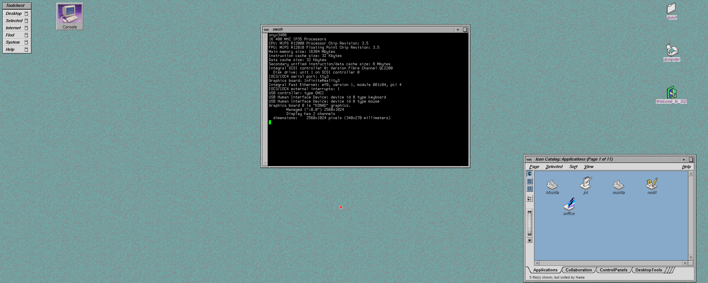
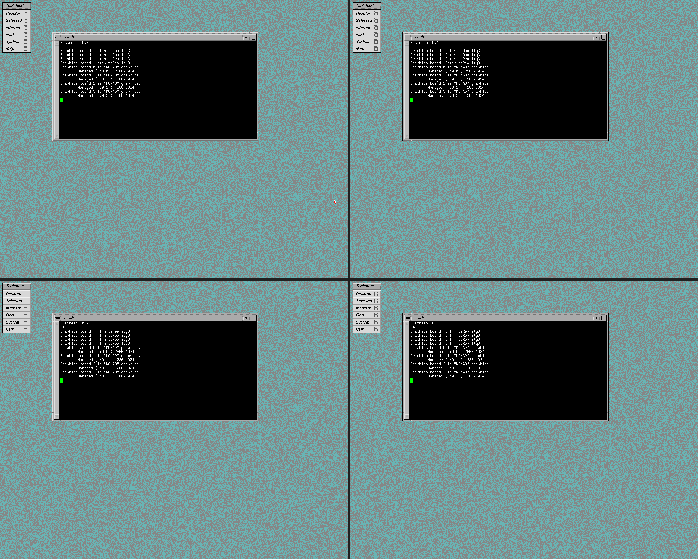
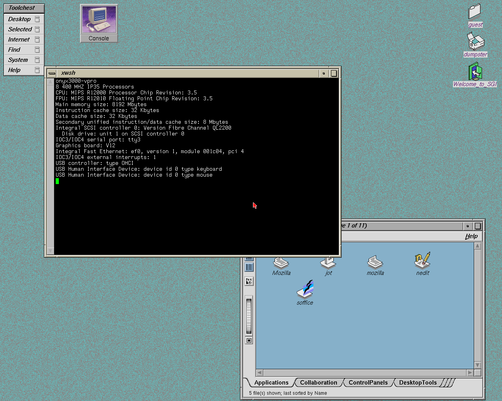
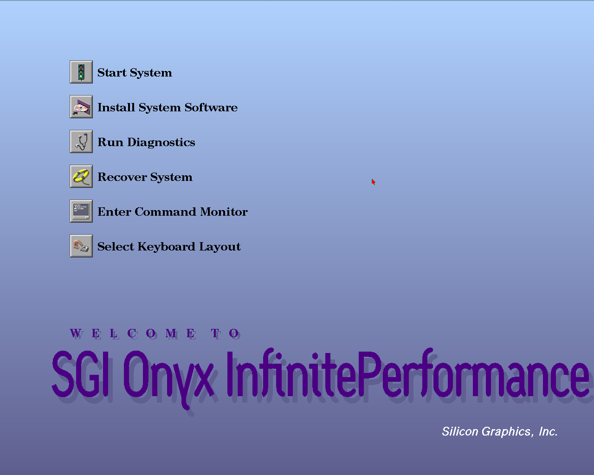
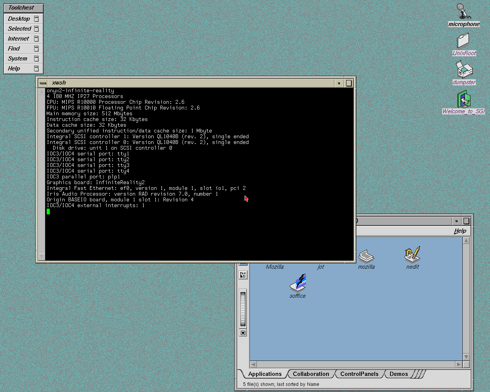

# Changelog

## Unreleased

The O2 runs, machines get stable identities, and disks can be MAME CHD images.

Breaking:
- Presets: `tezro-vpro` and `onyx350-vpro` are now `tezro` and `onyx350`. Migration: use the new names.
- origami upgrade: machines made by 0.5.1 must be upgraded to QEMU's topology names (`tezro-tower-multi` is `tezro-ip53`, `onyx350-compat` is `onyx350-ip53`, and the Origin 3000 clock topologies are processor modules). State is kept. Migration: run `origami upgrade` on each machine made by 0.5.1.
- Onyx 4: a host made by 0.5.1 cannot be upgraded, because QEMU now builds it only on the IP59 node board.

Features:
- CPU load: `OrigamiMachine::cpu_load()` returns each emulated CPU's load, user and system, sampled twice a second. It is the host's CPU time on the threads that emulate the CPUs, not the guest's own accounting. QEMU is measured on Linux and Windows, iris on Linux and macOS; otherwise the call says why not.
- iris: `origami create DIR --preset indy`, `indigo2` or `octane2-iris` makes an SGI Indy, Indigo2 or Octane2 (VPro V12, a 195 MHz R10000, the one iris offers) that runs on the iris emulator instead of QEMU. It runs in the runner process, so an iris fault ends that machine and nothing else. It needs a build with `--features iris`, and it is experimental: on Linux `run --display shm` serves the picture on a display protocol 4 socket (`state/display/v4.sock`; no pointer steering, so a viewer captures the mouse), a new Indy or Indigo2 PROM console is the graphics head (`setenv console d` at the PROM puts it on the serial line), it takes user networking only, no port forwards or shares, no power button or NMI, and no sound. The engine and its display also build for Windows and macOS: the display passes its conformance suite on Windows, the runner has not been built there yet (it needs an MSVC build), and macOS is compile-checked only until it runs on a Mac. Other iris machines (O2, Origin, Onyx, Fuel, Tezro) are not offered yet. `origami machines` still lists QEMU's presets; `origami machines indy` shows one of these.
- O2: the `o2` preset creates an R10000 O2 (IP32) with its published 4.18 PROM, which `create` strips of its update header and pads to the 512 KiB flash. The preset supplies the four board inputs QEMU requires (a password clear input of 1 and an unprotected, unlocked ROM part), and `--set` changes them. A run counts instructions with the virtual-time clock, as QEMU's machine list asks. Disks attach with `drive-attach --target`. `origami nvram` does not support the O2 yet, so a new O2's PROM keeps its console on the graphics head. The IRIX 6.5.30 login appears about five minutes after start.
- emu-id: every machine gets one at `create`, the lowest free number from 1 to 2999 among the machines beside it, and QEMU builds the guest's system serial, host id and Ethernet address from it. It is recorded in `machine.toml` as `[identity] emu-id` and passed to QEMU as `emu-id=N`. Concurrent creates in one directory never take the same one. `create --emu-id N` picks one from 1 to 2999; 3000 to 4095 are reserved for harness and CI machines. `show` prints it and `validate` warns when a neighbouring machine has the same one, or has emu-id 0 on tap or vmnet networking.
- Ethernet: a new machine's MAC derives from its emu-id unless `--mac` is given (42 gives `08:00:69:e1:02:a0`, and host id `69e102a0` on an Octane, Octane2, Origin 200 or Fuel). A machine that first gets a MAC from `network-set` or `install-init` gets an emu-id the same way.
- CHD disks: `drive-attach --type disk` takes a MAME CHD hard disk image. A compressed CHD takes guest writes in a `.diff.chd` beside it, folded back into the image when QEMU exits cleanly; `--overlay` keeps the diff instead. CD-ROM and tape CHDs are refused. Never use one CHD with iris and origami at the same time.
- Settings: `--set` takes the inputs the preset lists as settings, each checked for its kind of value. A list takes a slot, as in `--set chassis-eeprom.0=FILE`. `origami machines PRESET` lists them. A CPU input is `prid` or `fpu-id` instead of one name for each CPU part. `l2-controller` is listed but refused: the CLI starts no such process.
- CPU clock: `--processor` also picks the clock of an Origin 3200, 3400 or Onyx 3000.
- origami-gui: a viewer that draws each machine's graphics from shared memory (`run --display shm`), with serial and log views and controls. It is a testbed outside the release build: select it with `cargo build -p origami-gui`.
- Headless machines: a machine created without graphics (`--graphics none`) gets the serial line as its PROM console, since the PROM's default is the graphics head and a headless Octane2 panics installing from CD. A new machine's NVRAM is blank until the PROM has run, so the setting waits in `machine.toml` as `[firstboot]` and applies at the first start after the PROM has initialised the NVRAM, so the very first boot still uses the graphics console (not yet tested against a real first boot). Machines whose NVRAM `origami nvram` does not edit, such as the O2, are unchanged.
- machine-set: `origami machine-set DIR` changes a stopped machine's CPUs per node (`--cpus-per-node`), memory (`--memory-per-node`) and settings (`--set NAME=VALUE`, as `create` takes them) in one step, all or none. A running machine is refused, and so is a processor module other than the one the machine was made with, which its node flash records. `--set` replaces the value for its name and cannot remove one.
- Audio: a run gives the guest sound on the host's audio output (CoreAudio on macOS, PipeWire else PulseAudio on Linux, WASAPI else DirectSound on Windows), so the PROM's power-on chime plays on the machines that model audio. A QEMU without one of those backends runs the guest silent and says so in the runner log. `run --no-audio` turns it off. `show-command` no longer prints `-audio none`; the host's backend is chosen at run.
- reset and stop --force: `origami reset DIR` resets a running guest, and `origami stop --force DIR` kills QEMU at once. `state/run.json` records QEMU's own pid as `qemu_pid`.
- Cube: `origami-render` draws the SGI cube live on the GPU into a host window (`origami_cube_*` in the C frame plane): chrome reflecting a studio with a tintable horizon, a photograph of Howe Sound, Garibaldi Lake or Vancouver at dusk, or a running machine's screen, over granite. It turns at 10 rpm only when asked, drags and flings, draws at most 60 frames a second (30 while only the calm spin moves it) and nothing at rest or hidden.
- Linux app: machines show their product still in the sidebar, tabs, hero and New Machine, in the light or dark treatment, with a wash of the machine's measured colour. The start screen sits on granite of that colour under a plate, and the guest picture's letterbox is neutral granite. A machine with no still keeps its glyph tile.
- GTK app: the start page shows the SGI cube turning on chassis-coloured granite while a machine starts, and About is a dialog with the cube on a BC scene picked by the time of day. Both need a hardware GPU; with none, or a software one, the page keeps its spinner and About is the stock dialog.
- App packages: `cargo xtask dist --app` builds the native app's package for the host: a tarball with `bin/origami-gtk` on Linux, a `.app` archive on macOS (ad hoc signed, not notarized), and on Windows a zip with the WinUI app in `app/`. Each holds the `origami` tool, Instigator and the pinned QEMU, with the app's extra Rust crates and, on Windows, the .NET and Windows App SDK licences added to the notices. There is no installer or AppImage yet.

Changed:
- Console: the apps' serial console terminal runs on libghostty-vt 1.0.1 (MIT) instead of vt100, so it answers device attribute and cursor position queries, tracks wide characters and OSC 8 links, and keeps at least 5000 lines of history. Backspace sends ^H, which the PROM and IRIX erase on, and DEL once a Linux or OpenBSD banner appears, and a new run's console starts empty instead of replaying earlier boots. Linux builds the library with Zig on first build, once per target directory; macOS and Windows fetch upstream's prebuilt files, and the Windows app ships `ghostty-vt.dll` beside `origami_ffi.dll`. `--no-default-features` on origami-terminal or origami-ffi builds with vt100 only.
- Display: machines run on a QEMU with the `display-shm` device show through display protocol version 4, which lends the viewer a slot per frame and takes input and pointer steering on the same socket; an older QEMU keeps version 3. On Linux the GPU reads the slots in place, so the CPU copies no picture bytes.
- iris: the C frame plane can draw an iris machine's display (the `iris` feature of origami-ffi) and send it input, over display protocol 4; iris's red-first pixels are accepted without an extra copy on the GPU.
- Console: a second client of a machine's serial console no longer hangs. A runner process now owns the console, `origami console` and `install-apply` share it, and while an install holds the input lease the others are read-only, with a notice on standard error. `state/run.json` gains `control_port`, `engine_console` and `started_by`; `console_port` is now the runner's, and QEMU's own console is on `engine_console`. If the runner dies and QEMU lives, `status` says so, `stop` quits QEMU over QMP, and `console` connects to QEMU directly with a warning. `origami console` also shows a prompt that does not end in a newline at once.
- stop: waits until QEMU has exited and prints `stopped`, instead of returning once the quit is requested. A CHD disk folds its diff into the image during that exit, which takes minutes for a large image.
- origami upgrade: adds an emu-id to a machine that has none and keeps its MAC. On an Octane, Octane2, Fuel or Origin 200 the host id comes from the station address and stays the same. On the IP35 machines, Origin 2000 and Onyx2 it comes from a system serial that the emu-id sets, so the guest sees a new host id; `upgrade` says so and how to keep the old one.
- Origin 200: new machines get 256 MiB per node, up from 64 MiB (the `origin200-impact` GigaChannel preset had 128 MiB). Existing machines keep their size, and `--memory-per-node` still picks another.
- Origin 3000, Onyx 3000 and Origin 300: the NUMAlink expansion takes its onboard Ethernet address from the machine's, where they all used 08:00:69:12:34:56.
- Library: each machine shows its SGI product name, such as Origin 200, Origin 2000 or Onyx2. The Mac app showed "Origin" and "Onyx" for those models, and GTK and Windows showed the model id.
- Copied machines: a copied machine directory keeps its emu-id, and `run` warns, but still starts it, while the machine it was copied from is running. The two share a host id and Ethernet address, which clash on a shared network.
- Archive: the bundled QEMU is built with its chd driver, and the licence notices for MAME's CHD code ship with it.
- Archive: `THIRD_PARTY_NOTICES` lists every Rust crate `origami` links, generated from `cargo metadata`; it named about two thirds of them.
- QEMU: updated to 11169497b07, which reports machine list version 3. An older QEMU is refused.
- machine.toml: `origami upgrade` writes format 5, which names the engine in `[engine]` instead of `[qemu]` and records the firmware images a new machine's stores came from, and keeps the old file as `machine.toml.format4` (`.format1` to `.format3` for older machines). Older Origami versions cannot read format 5. Commands read a format 4 machine as it is, and a command that edits one writes format 5 and keeps the old file. A machine file from a later format is refused.
- Power Off: the core's clean stop gives up waiting after `stop_patience` (30 seconds). The operation then fails with a message that offers Force Quit, and the machine stays up instead of the front end waiting forever on a guest or QEMU that does not exit.

## 0.5.1

Big iron graphics. The Onyx 3000 with its V-brick VPro V12 and the Onyx 3400
with G-brick InfiniteReality3 are presets, and the Onyx 3400 takes up to four
pipes, each with a two-head DG5-2 display. IRIX 6.5.30 reaches the 4Dwm
desktop on every pipe, and one pipe's two heads join into a 2560x1024 desktop.

    $ hinv -c graphics    # Onyx 3400, four pipes
    Graphics board: InfiniteReality3
    Graphics board: InfiniteReality3
    Graphics board: InfiniteReality3
    Graphics board: InfiniteReality3

The [gallery](https://github.com/jamesbraid/origami/blob/v0.5.1/docs/gallery.md)
has a shot of each pipe and of the dual-head desktop.

- New:
  - Presets `onyx3000-vpro` and `onyx3400-infinite-reality`.
  - `create --graphics-pipes N` fits several pipes: 1 to 4 on the Onyx 3400
    and 1 to 2 on `onyx2-rack-infinite-reality`, whose second pipe gets the
    second node it needs.
  - A pipe's two heads join into one 2560x1024 desktop once `ircombine`
    stores the shipped `2@1280x1024_60` in the pipe's flash: the next start
    comes up that way. The usage guide has the command.
  - `run` shows every head of every pipe: a window for each head, or with
    `--display vnc` a VNC server for each on consecutive ports from
    `--vnc-port`.
- Changed:
  - Each InfiniteReality pipe keeps its flash in the machine's state as
    `SLOT-kona-flash.raw`. `origami upgrade` adds it to machines made
    before 0.5.1; without it QEMU refuses to start the machine.
- QEMU updated to 29ffcfb163. The Onyx 3000 boots without brick-type warnings from the PROM.

## 0.5.0

Big iron. The Origin 3200, 3400 and 3900 servers install and run IRIX
6.5.30, and any machine can now share a host folder with IRIX over NFS,
with no host NFS server or administrator rights.

    $ hinv            # Origin 3900
    16 700 MHZ IP35 Processors
    CPU: MIPS R16000 Processor Chip Revision: 3.0
    Main memory size: 8192 Mbytes
    ROUTER in Module 001c07/Slot 0: Revision 1: Active Ports [2,3,4,5,] (enabled)
    Integral SCSI controller 0: Version Fibre Channel QL2200, 33 MHz PCI
    Integral Fast Ethernet: ef0, version 1, module 001c07, pci 4

Every machine's `hinv` is in the [gallery](https://github.com/jamesbraid/origami/blob/v0.5.0/docs/gallery.md).

- New:
  - Presets `origin3200` (8 CPUs), `origin3400` (16 CPUs) and `origin3900`
    (16 R16000s). IRIX installs on the Origin 3200's Fibre Channel disk
    over its serial console, and the disk boots on the others.
  - `origami share DIR NAME HOSTDIR` serves a host folder to IRIX.
    Mount it with `mount 10.98.0.4:/NAME /mnt/NAME`.
  - `--mode private` with no install server running gives the guest its
    own network: `10.98.0.65` by DHCP, shares at `10.98.0.4`.
  - `network-set DIR --subnet 10.42.0.0/24` moves a machine's networks
    onto another private /24.
  - `install-init --release 6.5.22` installs IRIX 6.5.22, with MIPSpro
    and RAD4.
- Changed:
  - QEMU's user network is now `10.98.0.0/24`, the same as the private
    network: host `10.98.0.2`, DNS `10.98.0.3`, guest `10.98.0.65`. A
    machine that booted in user mode before may keep its old address
    once; run `rm /var/adm/proclaim.lease_info* /etc/resolv.conf` as root
    and restart it. Leave resolv.conf and IRIX's name service can start
    dead, failing every lookup until the next restart.
  - `/irix.cmds` installs every configured add-on, and
    `install-apply --addon` is gone.
  - Installs include the NFS client.
- Fixed:
  - An installed system is named after its machine directory, not IRIS.
  - After `network-set`, IRIX takes the new network's address.
  - Remote installs retry transient download errors instead of stopping.
- QEMU updated to cf2948f095. Instigator updated to 0.5.0.

## 0.4.1

Install IRIX on any graphics machine from its own console: the user guide
now walks through it with screenshots. This release also fixes what 0.4.0
left broken. Octane with SI shows its console, the Onyx 350 and Tezro
reach the network, and the VPro pointer is visible. VPro and
InfiniteReality are faster.

 

Every machine is in the [gallery](https://github.com/jamesbraid/origami/blob/v0.4.1/docs/gallery.md).

- Fixed:
  - Octane and Octane2 with SI no longer start to a black screen.
  - An Origin 200 with IMPACT installs X and reaches the 4Dwm desktop.
  - The Onyx 350 and Tezro connect their onboard Ethernet.
  - A new Onyx 350 starts on its graphics console.
  - The VPro pointer shows in the PROM and in X.
  - VPro no longer draws lighter squares behind desktop icons.
  - `/irix.cmds` installs the machine's add-ons too, so an Origin 200
    with RAD4 gets its X server.
- Faster:
  - The VPro textport scrolls about 4x faster.
  - Fuel, Tezro and Onyx 350 keep normal guest speed under heavy GL.
  - InfiniteReality texture loads are about 11x faster.
- New:
  - `origami nvram DIR` reads and changes a stopped machine's PROM
    environment, such as `console` and `AutoLoad`.
  - `show-command` prints a QEMU command you can copy, edit and run, and
    `[qemu] extra-args` or `--qemu-arg` add your own options.
  - `origami machines` prints one table of the presets; `origami
    machines PRESET` shows the detail.
  - `install-check` probes remote media instead of downloading it.
  - `create` gives each machine a unique SGI MAC. Non-SGI MACs are
    refused.
- QEMU updated to 49b5ef3757.

## 0.4.0

SGI graphics arrive. Nine machines now boot IRIX to a working GL desktop
with their own graphics hardware: Octane with SI, Octane2, Fuel, Tezro and
Onyx 350 with VPro V12, Origin 2000 with SI, Onyx2 with InfiniteReality2 or
InfiniteReality3, and Origin 200 with RAD4. Pick one with a preset, or any
board QEMU models with `create --graphics`.

Machines created by 0.3.x must be upgraded once: `origami upgrade DIR`.
An Origin 2000 or Origin 200 with InfiniteReality is refused, because that
hardware is an Onyx2: create an Onyx2 instead.

- New presets: `octane2-vpro`, `origin2000-impact`,
  `onyx2-rack-infinite-reality`, `onyx350-vpro` and `tezro-vpro`.
  `fuel-1` now comes with its VPro V12.
- `origami machines` lists every graphics board each machine takes, and its
  known limits.
- New Origin 2000 and Onyx2 machines get 256 MiB per node, the smallest
  SGI shipped, instead of 64 MiB. Existing machines keep their size.
- QEMU updated to 4013f9f84f.

## 0.3.1

- An Origin 200 can take any of its processor modules:
  `create --processor ID` picks a 180 MHz R10000 with 1 MB (the default)
  or 2 MB cache, a 225 MHz R10000 or a 270 MHz R12000, and `origami
  machines` lists them. The two faster modules always hold two CPUs and
  allow up to 1792 MiB per node. The module is fixed when the machine is
  created. Existing machines keep the default module and need no upgrade.
- Piping output, as in `origami machines | head`, ends quietly instead of
  panicking.
- `origami --version` reports Instigator as v0.4.0. The 0.3.0 archives
  showed a pseudo-version for the same code.
- QEMU updated to 47542527ab.

## 0.3.0

Machines created by 0.2.x must be upgraded once: `origami upgrade DIR`.
Origin 200, Origin 2000 and Onyx2 machines gain a module controller NVRAM
file built from their PROMs, which the upgrade downloads or takes from
`--prom FILE` and `--io-prom FILE`. Flash, NVRAM, drives and network
settings are kept.

Install profiles are now `minimal` and `standard`; `base`, `desktop` and
`development` are gone. The MIPSpro compiler is an add-on:
`--profile standard` with `install-addon --name mipspro`.

Source checkouts: QEMU now comes from github.com/jamesbraid/qemu-sgi-origami.
Run `git submodule sync && git submodule update` once.

- Origin 200 presets are headless. The new `origin200-rad4` preset is the
  two-CPU Origin 200 with RAD4 graphics, and `install-init` adds the RAD4
  add-on for it.
- Add-ons install in a second `inst` pass after IRIX, and `install-apply`
  restarts the guest to its login prompt. `install-finish` is gone.
  Without `--addon`, `install-apply` installs every configured add-on.
- RAD4 keeps the driver's DMA on, which makes window drags and resizes
  several times faster. On an existing RAD4 install, set
  `rad4pci_no_dma = 0` in `/var/sysgen/master.d/rad4pci`, run `autoconfig`
  and reboot.
- Guided installs turn on DHCP and `AutoLoad`. A cold start boots straight
  to IRIX, which gets its address and its hostname (the machine directory's
  name) from user networking.
- `minimal` installs no longer stop at package conflicts.
- `network-set --mode tap` (Linux, Windows) and `--mode vmnet` (macOS, via
  socket_vmnet) put the guest on a host network.
- Origin 200 accepts more memory sizes, up to 1664 MiB per node.
- QEMU updated to 24b27ce. Instigator updated to v0.4.0.

## 0.2.1

- QEMU updated to fa81284.
- The CLI talks to QEMU through the qapi library instead of its own
  protocol code.

## 0.2.0

Machines created by 0.1.x must be upgraded once before use:
`origami upgrade DIR`. Origin 2000 and Onyx2 machines may need
`--io-prom FILE` if the IO PROM cannot be downloaded. PROM settings,
logs, drives and port forwards are kept, and the old files stay in place.

- The machine list now comes from the bundled QEMU, so the CLI and QEMU
  always agree on what each machine supports.
- QEMU now creates a new machine's flash, NVRAM and clock files.
- Each machine has one MAC address, used for its Ethernet.
- QEMU updated to 370fbb5.

## 0.1.2

- Fix PROM downloads, which failed for every machine in 0.1.1.

## 0.1.1

First public release.

- Portable archives for Linux, Windows and MacOS
- QEMU's libraries come from pinned vcpkg ports instead of the build host.

## 0.1.0

First preview, not published as a release.

- The `origami` CLI creates, runs and stops Origin 200, Origin 2000,
  Origin 300 and Onyx2 machines from presets. Fetches PROMs on demand.
- Tested with IRIX installing from scratch on an emulated Origin 200 with RAD4
  graphics.
