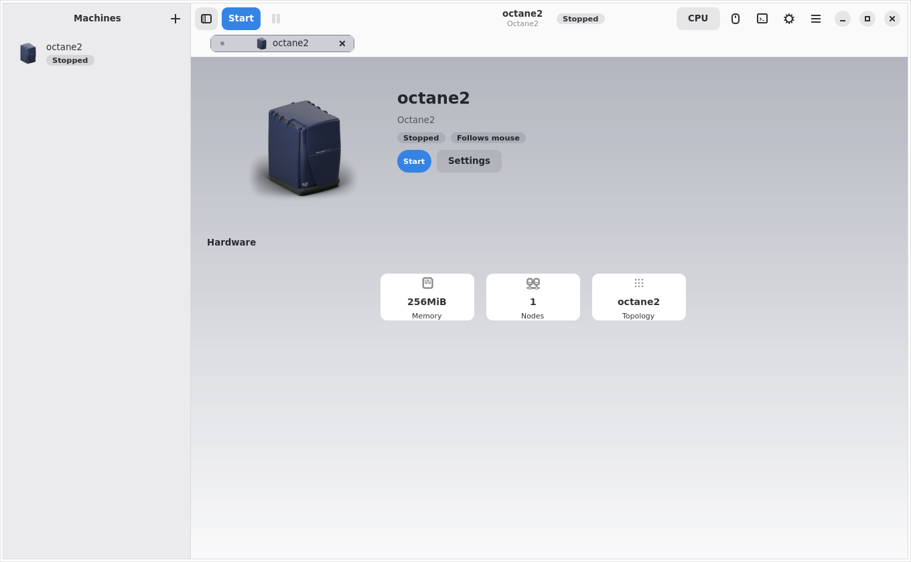
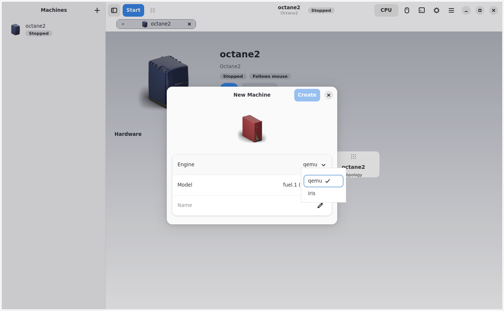
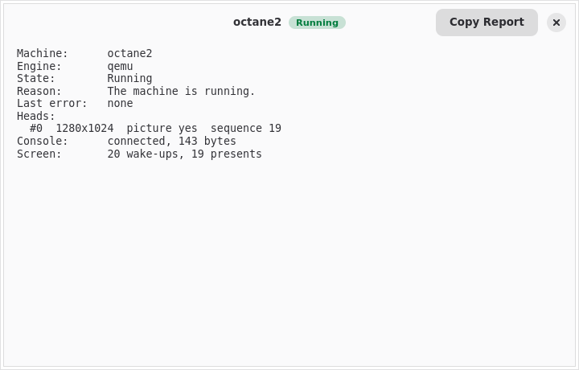
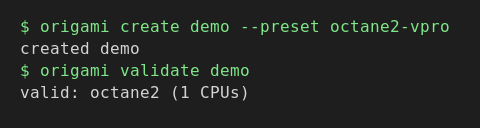
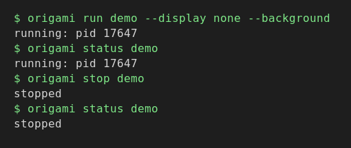

# The Origami app

[Back to the README](../README.md)

Origami has a desktop app for Linux, macOS (Apple Silicon) and Windows. It
keeps a library of machines, starts them, shows their screens and serial
consoles, and edits their settings. It runs the same machines as the
[`origami` command](usage.md) and uses the same machine directories, so you can
create a machine in one and run it from the other.

| Linux | macOS | Windows |
|---|---|---|
|  |  |  |

The walkthrough below uses the Linux app; macOS and Windows have the same
windows with their own look and shortcuts.

This guide follows one session: create a machine, pick an engine, start it,
use the console, pause it, take a screenshot, and look at Diagnostics, the CPU
panel and About.

## Get the app

Each release has an app archive per platform next to the command-line one:
`origami-0.6.0-linux-x86_64-app.tar.gz`, `origami-0.6.0-macos-arm64-app.zip`
and `origami-0.6.0-windows-x86_64-app.zip`. Extract it, keep the extracted
files together, and start `bin/origami-gtk` (Linux), `Origami.app` (macOS) or
the executable in the `app` folder (Windows). The first time a machine needs
firmware, the app downloads and checks it, as `origami create` does.

The library is a folder of machine directories. The app starts with:

| Platform | Library folder |
|---|---|
| Linux | `~/.local/share/origami/machines` |
| macOS | `~/Library/Application Support/Origami/Machines` |
| Windows | `%LocalAppData%\Origami\Machines` |

Machines you made with `origami create` appear once their directory is in that
folder. On Linux, `origami-gtk --library DIR` opens another folder; on macOS
and Windows use `--machines DIR` and `--library DIR` respectively.

## The window

The library is on the left, one row per machine with its state. Selecting a
row shows the machine on the right: its picture, name, state and a Start
button, with Memory, Nodes and Topology below. Double-click a row, or use
Open in New Tab in its right-click menu, to keep several machines open in
tabs. The toolbar has Start or Power Off, Pause, the pointer mode, the
Console, Settings and the main menu. The CPU button shows the
[CPU panel](#the-cpu-panel). A machine with no graphics opens straight to its
console.

## Create a machine

Choose New Machine (the **+** above the library, or Ctrl+N; Cmd+N on macOS).
The dialog asks for three things.

**Engine** is the emulator that runs the machine. QEMU runs every machine
Origami knows. iris is a second, experimental engine for the Indy, Indigo2
and Octane2. When a model is offered by one engine only, the list has one entry.

**Model** is the machine to build: an Octane2, an Origin 200 and so on, with
its CPU count. The list follows the engine you picked. **Name** is the
machine's name and its directory name. Press Create. Creating a machine for
the first time downloads its PROM and checks it. It is the same step as
`origami create NAME --preset PRESET`; [Create a machine](usage.md#create-a-machine)
lists the presets.

## Start it

Select the machine (the window picture above) and press Start (Ctrl+Shift+R; Cmd+R on macOS). The
machine's page shows a starting screen while the emulator launches. Until it
is up, the button reads Force Quit rather than Power Off.

When the guest draws, its screen replaces the page. This is an Octane2's PROM
menu.

The picture goes from the emulator to your GPU without the CPU copying it
where the platform allows. If it cannot, the app copies it instead, and
[Diagnostics](#diagnostics) says why.

Click the screen to type and use the mouse in the guest. The pointer button in
the toolbar picks how the mouse works. *Follow My Mouse* makes the guest's
pointer track yours while it is over the screen. *Capture on Click* takes the
mouse and keyboard when you click and hands them back on Ctrl+Alt (Linux).

Power Off asks the guest to stop. If the guest has not stopped after 30
seconds, the app offers Force Quit, which ends the emulator at once; the guest
does not get to write its disks. When you quit the app with machines running,
Keep Running leaves them going without it.

## The console

The Console button (Ctrl+Shift+O; Alt+Cmd+C on macOS) opens the machine's
serial console in its own window, one window per machine. It is a real
terminal, so IRIX's tools see colours, function keys and wide characters, and
it keeps 5000 lines of history. Each run starts with a clean console. On
Linux, select with the mouse and copy with Ctrl+Shift+C, paste with
Ctrl+Shift+V or Shift+Insert, and scroll back with the mouse wheel or
Shift+Page Up.

This one shows the PROM's power-on messages on a machine whose console was set
to the serial line with `origami nvram MACHINE set console=d`. A machine
whose console is graphics prints little here. The NVRAM checksum warning and
the failed disk diagnostics are normal on a new machine's first boot: the PROM
sets up its NVRAM and finds no disks yet. See
[Which serial line is the console](usage.md#which-serial-line-is-the-console).

## Pause and resume

Pause (Ctrl+P on Linux and Windows; on macOS use the Machine menu) freezes
the machine in place. Its state reads Paused and the toolbar button becomes
Resume. Resume carries on where it left off.

## Screenshots

Choose Screenshot from the Machine menu while a machine runs (Save Screenshot,
Cmd+Shift+S, on macOS). The app saves the guest's screen as a PNG in your
Pictures folder, named like `octane2 2026-11-18 at 14.30.05.png`. It is the
guest's own picture, not a capture of your window. Linux shows a toast with a
Show in Files button. Windows puts the file name in the status bar with a
button that opens Explorer, and macOS announces the file and can reveal it in
Finder.

## Diagnostics

Diagnostics (Ctrl+Shift+L; Alt+Cmd+L on macOS, or the row's right-click menu)
opens a text report for the selected machine: its engine, state, the last
error, each graphics head with its size and whether it has a picture, the
console's connection and how many frames the screen has received and shown.
Copy Report puts it on the clipboard. Attach it to a bug report.

When a machine stops unexpectedly, the report's Reason and Last error say why.

## The CPU panel

The CPU button shows a bar for each emulated CPU under the picture, user time
in blue and system time in red, with the total at the right. The numbers are
measured on your computer, not inside the guest, so they show how hard the
emulation works, not what IRIX reports. The PROM's menu keeps its CPU busy,
which is why this one reads 100%. The panel updates twice a second while it is
shown and does no work when hidden.

## Settings

Settings (Ctrl+Shift+I; Cmd+I on macOS) edits the selected machine's file:
its name, memory and processor, graphics, drives, network and input. The
Network page includes port forwards from the host to the guest. A running
machine refuses edits; stop it first.

## About

About shows the version, credits for the backdrop photographs and the
licence. This is the plain dialog you get without a GPU; with one the window
also shows a chrome cube. The version here, 0.0.0, is a development build's; a
release shows its own.

## The same from the command line

The same machines work from the CLI, on the same directories:

`origami machines` lists the presets, `create` makes a machine, `run` starts
it and `status` and `stop` follow it. [Using Origami](usage.md) covers the
rest.
