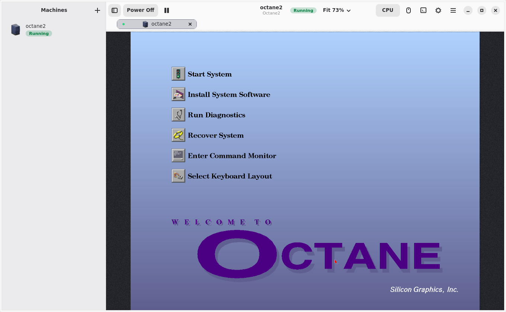
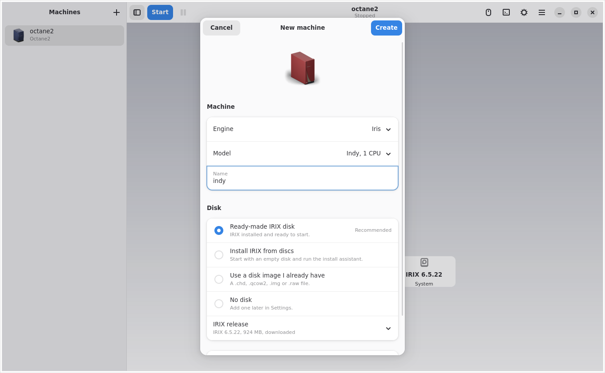
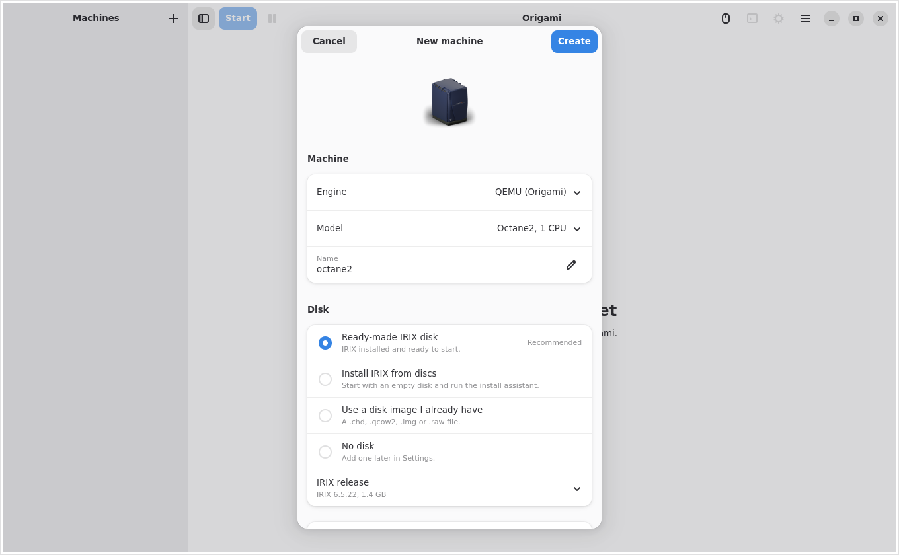
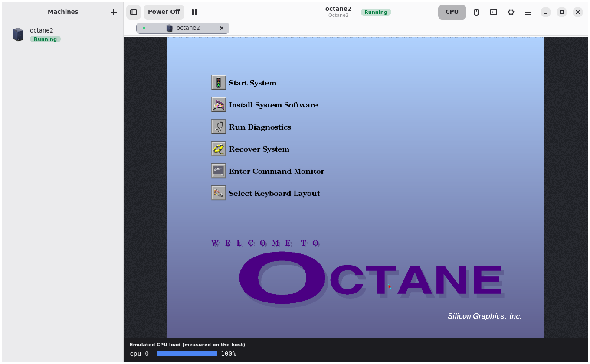
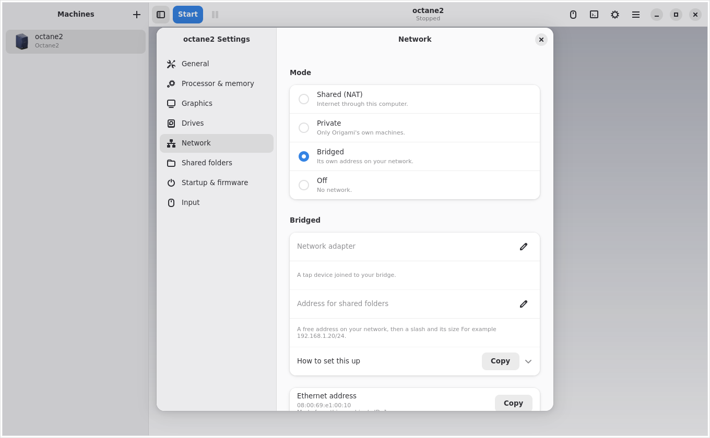
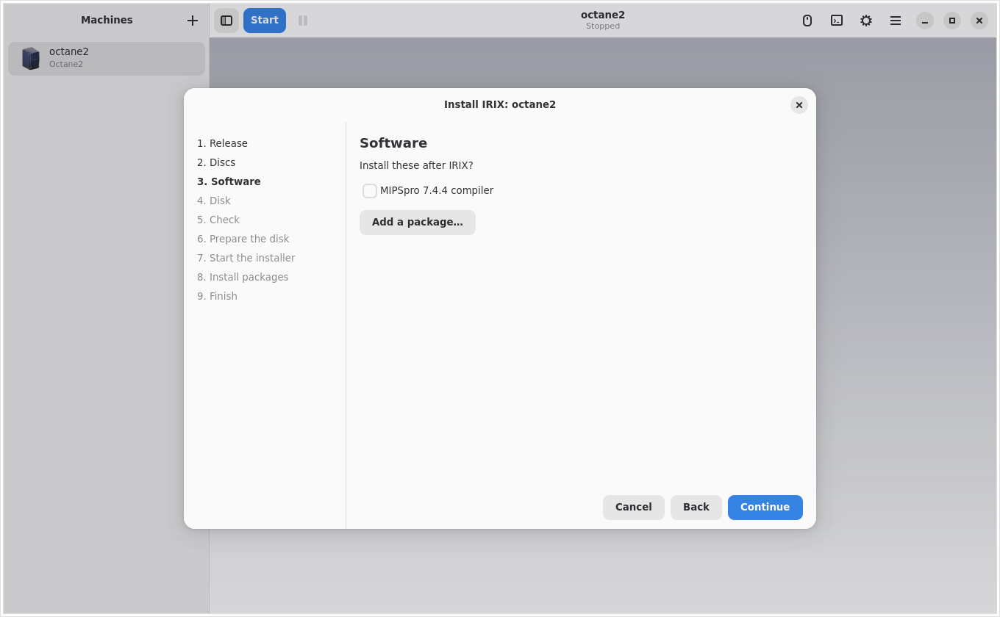

# The Origami app

[Back to the README](../README.md)

Origami has a desktop app for Linux, macOS (Apple silicon and Intel) and Windows. It
keeps a library of machines, starts them, shows their screens and serial
consoles, and edits their settings. It runs the same machines as the
[`origami` command](usage.md) and uses the same machine directories, so you can
create a machine in one and run it from the other.

| Linux | macOS | Windows |
|---|---|---|
|  |  |  |

The walkthrough below shows the Linux app; macOS and Windows have the same
windows with their own look and shortcuts.

This guide follows one session: create a machine, pick an engine, start it,
use the console, pause it, take a screenshot, and look at Diagnostics, the CPU
panel, Settings, the Install IRIX assistant and About.

## Get the app

On Windows, run `origami-<version>-windows-x86_64-setup.exe` or
`origami-<version>-windows-arm64-setup.exe` from the
[release page](https://github.com/jamesbraid/origami/releases). It installs
for you alone under `%LocalAppData%\Programs\Origami` without asking for
administrator rights (the first page offers all users), adds Origami to the
Start menu and the `origami` command to PATH (untick the box to skip that),
and replaces an older install in place. Open a new terminal to use `origami`.
Uninstall it from Settings, Apps; your machine library is never touched.

On Linux and macOS, or on Windows if you would rather not install, pick the
app archive for your computer from the same page:
`origami-<version>-linux-x86_64.tar.gz`, `origami-<version>-linux-arm64.tar.gz`,
`origami-<version>-macos-universal.zip` (one download for Apple silicon and
Intel Macs), `origami-<version>-windows-x86_64.zip` or
`origami-<version>-windows-arm64.zip`. The app archive includes
the `origami` command, so you do not need the `origami-cli-` archive beside
it. Extract it, keep the extracted files together, and start `bin/origami-gtk`
(Linux), `Origami.app` (macOS) or the executable in the `app` folder (Windows).
The first time a machine needs
firmware, the app downloads and checks it, as `origami create` does.

Releases are signed: the Mac app is signed and notarized, and the Windows
installer, app and command are signed. A build from a fork or a development
build is not, and macOS Gatekeeper blocks it and Windows SmartScreen flags it.
On macOS, run `xattr -dr com.apple.quarantine Origami.app` once after
extracting. On Windows, choose More info, then Run anyway.

The library is a folder of machine directories. The app starts with:

| Platform | Library folder |
|---|---|
| Linux | `~/.local/share/origami/machines` |
| macOS | `~/Library/Application Support/Origami/Machines` |
| Windows | `%LocalAppData%\Origami\Machines` |

Machines you made with `origami create` appear once their directory is in that
folder. On Linux, `origami-gtk --library DIR` opens another folder; on macOS
and Windows use `--machines DIR` and `--library DIR` respectively.

## The window

The Machines list is on the left, one row per machine: its name over its model,
or over its state as a dot and a word when it is not stopped. Selecting a row
shows the machine on the right: its picture and a Start button, with cards
below for its Memory, its Model, the System on its disk when Origami recognises
one (such as IRIX 6.5.30), and its Nodes on a machine that has several. The
machine's name and state head the window, and the state is shown there and in
its row, and nowhere else. Double-click a row, or use
Open in new tab in its right-click menu, to keep several machines open in
tabs. The toolbar has Start or Power off, Pause, the pointer mode, the
Console, Settings and the main menu. The CPU button shows the
[CPU panel](#the-cpu-panel). A machine with no graphics opens straight to its
console.

On macOS a row is the machine's name over its model, or over its state as a dot
and a word when it is not stopped. The title bar names the open machine with
its state under it, and its first toolbar button shows or hides the library
whether it is open or not. The toolbar's Start button becomes the Power off
menu once the machine is up (Pause or Resume, Reset and Force quit are in the
menu), the pointer is one Capture mouse toggle, and the tab bar appears only
when a second machine is open. A status bar under a running machine shows the
picture's size and the pointer. Help > Keyboard shortcuts lists every shortcut,
the keys that release the mouse first.

On Windows the title bar holds only the icon and name. The pane at the left
has a toggle at its top and New machine at its foot, and Delete… in a row's
menu (or the Delete key) sends a stopped machine to the Recycle Bin after
asking. The machine's name and state head the page, with a command bar:
Start, which becomes a Power off button with Pause, Reset and Force quit
beside it, then Console, Capture mouse and Settings. More has CPU load,
Diagnostics, Screenshot, Install IRIX, Keyboard shortcuts, Preferences and
About. A toast takes the place of the status bar for a few seconds, so the picture never changes size. Settings has eight pages. While an install runs the pane shows its
steps instead of the machines. Drop a CD image on the page to change the CD,
or a disk image on the pane to start a new machine from it.

## Machines from an older Origami

A machine made by an older release says **Needs upgrade** in the library and
cannot start. Open it and choose Upgrade (on Linux, its card in the window
offers Upgrade, and a toast says when it is done). This is [`origami upgrade`](usage.md#upgrading-a-machine):
flash, NVRAM, drives, network settings and the Ethernet address are kept, and
what the guest will notice at its next boot is listed when it is done. A
machine that needs firmware to be rebuilt downloads it. If that fails, the
message gives the `origami upgrade` command that takes local firmware files.
If an upgrade fails, the reason is shown. The machine file stays as it was unless the upgrade had already rewritten it.
On macOS a failed upgrade that needs firmware offers Choose firmware files…, and a
successful one shows a brief toast naming the machine.

## Create a machine

Choose New machine (the **+** above the library, or Ctrl+N; Cmd+N on macOS).
The dialog asks for three things.

**Engine** is the emulator that runs the machine. QEMU runs every machine
Origami knows. Iris is a second, experimental engine for the Indy, Indigo2
and Octane2. When a model is offered by one engine only, the list has one entry.
On macOS the list is left out when there is only one engine.

**Model** is the machine to build: an Octane2, an Origin 200 and so on, with
its CPU count, such as "Fuel, 1 CPU". The list follows the engine you picked. **Name** is the
machine's name and its directory name. Press Create. Creating a machine for
the first time downloads its PROM and checks it. It is the same step as
`origami create NAME --preset PRESET`; [Create a machine](usage.md#create-a-machine)
lists the presets.

**Disk** is the machine's system disk. The choices are a ready-made IRIX disk
(first, and marked Recommended, when one is offered for the model), install
IRIX from discs, which starts with an empty disk of the size you give (4 GB to
start with) and opens the install assistant, a disk image you already have
(CHD, qcow2 or raw), or no disk.
Use a disk made for the same kind of machine. An image is copied into the
machine's folder, which keeps your original safe and the machine in one
place, or used where it is. A CHD keeps its changes apart from your file
unless you choose to save into the image. A copy shows its progress and can be
cancelled; a cancelled copy leaves the machine without a disk. The sheet
warns when another machine already uses the file. Origami reads what is on the
disk, such as "IRIX 6.5.30" or "OpenBSD 6.9", or "Unknown", and shows it as the
System card on the machine's page. This is
[`drive-create`](usage.md) and `drive-attach` from the command line.

When the disk server lists a ready-made, boot-checked IRIX disk for the model
you picked, **Ready-made IRIX disk** is offered, with a list of IRIX
releases and their sizes.

Create downloads the disk once, checks its SHA-256
and copies it into the machine's folder with its changes kept apart; the
download shows its progress and can be cancelled, and a stopped download
resumes; one that gets no data for a minute stops with a message to try
again. Cancelling the download makes no machine and keeps the part already
fetched; cancelling the copy that follows leaves the machine without a disk.
The disk must fit the model and both the download folder and the library need
room before it starts. Downloads are kept in one shared folder in the cache directory, with
no size limit and no automatic cleanup, so a second machine starts from the
same file without downloading again. Preferences, Storage lists them with a
Remove button, which asks first and is refused while a disk is being downloaded or copied.
The machine gets its own copy because the CHD driver keeps its
changes beside the image file and offers no way to put them elsewhere.

**Advanced** holds the machine ID and the Ethernet address. The ID is the
lowest free number from 1 to 2999 and makes the serial number, host id and
Ethernet address, so two machines in one folder never share them. Choose
another number, or give an address of your own for a machine that will sit on
your network. The sheet says why a number or address cannot be used. It is
`origami create --emu-id` and `--mac`.

## Start it

Select the machine and press Start (Ctrl+Shift+R; Cmd+R on macOS). The
machine's page shows what the start is doing while the emulator launches: the
emulator, then the screen, and the newest line from the console. Until the
machine is up, the button reads Cancel start rather than Power off.

When the guest draws, its screen replaces the page. This is an Octane2 that has
booted IRIX from its ready-made disk, at the login screen.

The picture goes from the emulator to your GPU without the CPU copying it
where the platform allows. If it cannot, the app copies it instead, and
[Diagnostics](#diagnostics) says why.

The picture fills the window at any size, keeping its shape. macOS and Windows
draw in-between sizes sharp: each guest pixel stays flat and blends only at its
edge. Linux still smooths sizes between whole steps above 1x.

Click the screen to type and use the mouse in the guest. The pointer button in
the toolbar picks how the mouse works. *Follow my mouse* makes the guest's
pointer track yours while it is over the screen. *Capture on click* takes the
mouse and keyboard when you click and hands them back on Ctrl+Alt (Linux).

Power off, Reset and Force quit ask first, and the safe answer, Cancel, is the
default. Power off asks the guest to stop. If the guest has not stopped after 30
seconds, the app offers Force quit, which ends the emulator at once; the guest
does not get to write its disks. When you quit the app with machines running,
Keep running leaves them going without it.

## The console

The Console button (Ctrl+Shift+O; Alt+Cmd+C on macOS) opens the machine's
serial console in its own window, one window per machine. It is a real
terminal, so IRIX's tools see colours, function keys and wide characters, and
it keeps 5000 lines of history. Each run starts with a clean console. On
Linux, select with the mouse and copy with Ctrl+Shift+C, paste with
Ctrl+Shift+V or Shift+Insert, and scroll back with the mouse wheel or
Shift+Page Up.

A machine whose console is set to a serial line prints its PROM and system
messages here; one whose console is graphics prints little. Choose the line in
Settings, on the Startup & firmware page, or with
`origami nvram MACHINE set console=d`; see
[Which serial line is the console](usage.md#which-serial-line-is-the-console).
On a new machine's first boot the PROM warns about the NVRAM checksum, which
is normal. A machine with no disk also reports failed disk diagnostics until an
operating system is installed.

## Pause and resume

Pause (Ctrl+P on Linux and Windows; on macOS use the Machine menu) freezes
the machine in place. Its state reads Paused and the toolbar button becomes
Resume (on Linux the picture is dimmed with a Resume button over it). Resume carries on where it left off.

## Screenshots

Choose Screenshot from the Machine menu while a machine runs (Save screenshot,
Cmd+Shift+S, on macOS). The app saves the guest's screen as a PNG in your
Pictures folder, named like `octane2 2026-11-18 at 14.30.05.png`. It is the
guest's own picture, not a capture of your window. Linux shows a toast with a
Show in Files button. Windows shows a toast with a Show in Explorer button, and macOS announces the file and can reveal it in
Finder.

## Diagnostics

Diagnostics (Ctrl+Shift+L; Alt+Cmd+L on macOS, or the row's right-click menu)
opens a text report for the selected machine, worded by the core so all
three apps show the same lines: its model, engine, status, details, the last
error, each display with its size and whether it has a picture, the
console's connection and how many frame updates the screen has received and
shown. Copy report puts it on the clipboard. Attach it to a bug report.

When a machine stops unexpectedly, the report's Details and Last error say why.

## The CPU panel

CPU load (in the main menu on Linux) shows a bar for each emulated CPU under the picture, drawn in
the style of IRIX's `gr_osview`: a title and a coloured legend over a framed
bar cut into user (blue), sys (red) and spare (green), with a ruler marked in
tenths. The numbers are measured on your computer, not inside the guest, so
they show how hard the emulation works, not what IRIX reports. Spare is the
share of a host core the CPU's thread did not use. `gr_osview`'s interrupt,
wait, memory and graphics bars need a view inside the guest and are not shown.
The panel updates twice a second while it is shown and does no work when
hidden.

## Settings

Settings (Ctrl+Shift+I; Cmd+I on macOS) edits the selected machine's file:
its name, processor and memory, graphics, drives, network, shared folders, startup and firmware, and input.
The Network page picks how the machine connects: Shared (NAT), Private,
Bridged or Off. Bridged gives the machine its own address on your network
through a tap device on Linux and Windows, or socket_vmnet on macOS. Its two
fields are named in plain words, Network adapter (Network connection on macOS)
and Address for shared folders, each with a line saying what it takes; How to set
this up gives the steps and the commands to copy. It also shows the
machine's Ethernet address, which you can copy but not change, and the private
subnet under Advanced. After a change that moves the machine to a different
network, the page shows the command that makes the guest forget its old
address. This is [`origami network-set`](usage.md#join-a-real-network).

The page also holds port forwards from the host to the guest. Shared folders
shares a folder of this computer with the guest over NFS: pick the folder, give it a
name, and the page shows the two commands to run as root in IRIX to mount it,
with Copy. This is [`origami share`](usage.md#share-a-host-folder). Startup
and firmware picks the console serial line, the same choice as
[`origami console-set`](usage.md#which-serial-line-is-the-console). A running
machine refuses edits; stop it first, except for the CD-ROM. The Drives page
adds a disk image and inserts a CD-ROM image. Change CD and Eject work while
the machine runs.
Detach asks first; the drive's disk image is not deleted.

## Remove a machine

Move to Trash… (Delete… on Windows) removes a stopped machine from the library
by moving its folder, with its disks and settings, to the platform's trash. It is in the
row's right-click menu and the Machine menu (Cmd+Backspace on macOS). A disk
image the machine used in place, outside its folder, stays where it is and the
alert says so.

## Drag and drop

On macOS, drop a CD image on a running machine to change its CD, or a disk image
on the library to open New machine with that disk chosen.

## Install IRIX

Machine > Install IRIX… opens the install assistant for a stopped machine.

On macOS the set-up steps (release, discs, software, method, disk and check) are
a sheet; once the install starts the sheet closes and the guide takes the sidebar,
beside the machine's screen or, on a serial console, its console. A toolbar button
switches the sidebar between the guide and the library. Each step names what to watch
for and what to type, and a serial console marks it done when the prompt shows;
a graphics console has a Done button. Continue is always at the foot, as in the other apps, with the reason beside it when it is off; pressing it counts the page's steps as done.
On Linux the set-up steps are a window; once the install starts the guide
opens beside the machine's screen, with finished steps folded to one line and
the current step showing what to watch for and what to type.
New machine can open it for you: choose Install IRIX from discs. It is the app's version of
[Install IRIX](usage.md#install-irix) from the command line. The assistant
gets everything ready, serves the discs and lists each step with the
machine's own release and addresses in it.

Choose the release and profile (IRIX 6.5.30 Standard or Minimal, or 6.5.22;
an Indy or Indigo2 also offers IRIX 6.2 and 5.3, which have the Standard
profile only and take no extra software, so their Software step is skipped),
then where the discs come from: downloaded from the Origami server while the
install runs, or a folder of disc images you already have, which the
assistant checks as soon as you choose it. Tick the software to add after
IRIX, such as MIPSpro, or add a package from a file or an HTTPS address. The
Disk step creates a system disk when the machine has none and asks before it
erases one it has. Check switches the machine to the private installation
network and checks every disc; Check thoroughly also reads the downloaded
ones.

On a machine whose PROM prints on a serial line, a Method step asks how the
install should run. Automatic, the default, types the package commands for
you: at `Inst>` press Install and Origami loads the install script, restarts
the machine, logs in as root and runs `halt -p`, while the Console shows the
guest and is read-only. It types nothing unless the console ends at `Inst>`.
If a conflict or a failed command stops it, the message says so and the guest
waits at `Inst>`: fix it in the Console and press "I fixed it at Inst>" to
finish by hand. If the packages went in but the login or `halt -p` failed,
use the Console to halt IRIX; Continue turns on once the machine has stopped.
Guided shows the commands for you to type. A machine with graphics keeps its
screen as the console, so it is always Guided, and the assistant never
switches a machine's console.

The next three steps start the media server and the machine, then list what
to do: label the disk, start the installer and install the packages. Copy
puts a command on the clipboard. On a machine whose console is a serial line,
Type it sends it to the console for you. A machine with graphics keeps its
screen as the console and is never switched to serial. Show machine and Open
Console bring the machine and its console forward. The footer shows what the
media server is serving, and says how far the machine has loaded the installer
or the disk tool while it does. It turns red with a Restart button if the
server stops, and with Instigator 0.6.0 or newer says why in the server's own
words. Cancel stops the media server, and in the middle of the
install asks whether to stop the machine too. Quitting the app while the
server runs asks first, because the server stops with the app.

When the machine has stopped after `halt -p`, Finish puts the network back as
it was before the install, stops the media server and closes the assistant.
Closing earlier offers the same on a stopped machine, and a machine left on
the installation network offers it the next time you open the assistant.
Reopening on a machine that is already set up starts at the Disk step, with
Start over to begin again. Install IRIX is for machines that run IRIX.

## About

About shows the version, who made Origami and the project link. Its
Acknowledgements button lists what Origami is built on (QEMU (Origami) with the link to
the source of the bundled build, Iris, Ghostty's terminal library and
Instigator), the thanks, and each photograph and the artwork with its licence.
Its Licences button opens the full text of every licence bundled, grouped by
licence with the components under each, and a search box.

## The same from the command line

The same machines work from the CLI, on the same directories:

`origami machines` lists the presets, `create` makes a machine, `run` starts
it and `status` and `stop` follow it. [Using Origami](usage.md) covers the
rest.
