# Gallery

Every preset, booted from IRIX 6.5.30: the PROM menu and the 4Dwm desktop
running `hinv` for the graphics machines, and `hinv -v` for the servers.

## Octane2 with VPro V12 (`octane2-vpro`)

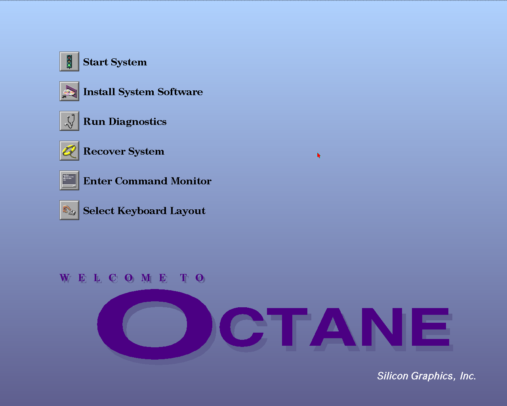


## Octane and Octane2 with SI (`octane-impact`, `octane2-impact`)


## Fuel (`fuel-1`)


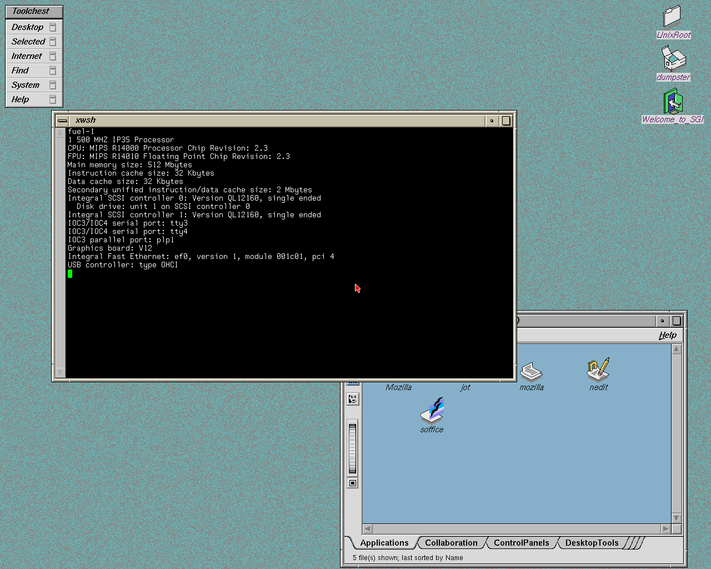

## Tezro (`tezro-vpro`)

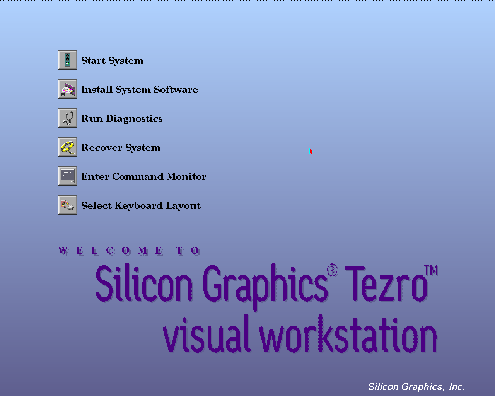


## Onyx 350 (`onyx350-vpro`)

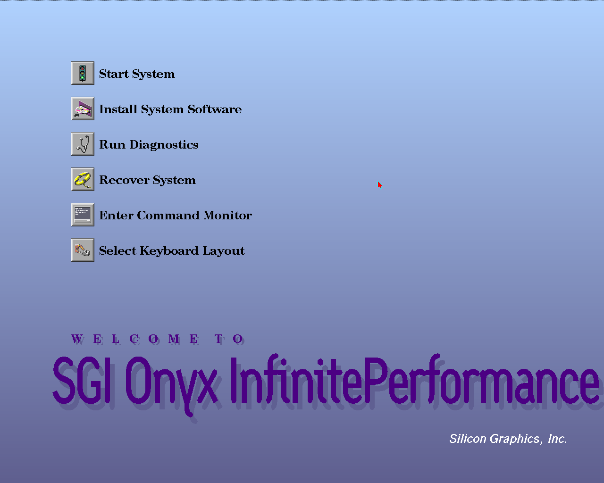


## Onyx2 with InfiniteReality (`onyx2-infinite-reality`, `onyx2-rack-infinite-reality`)

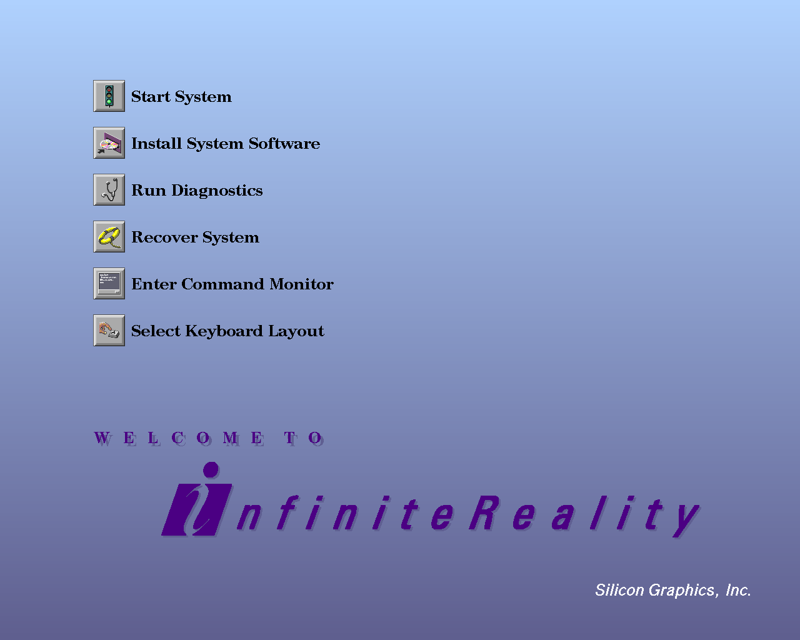

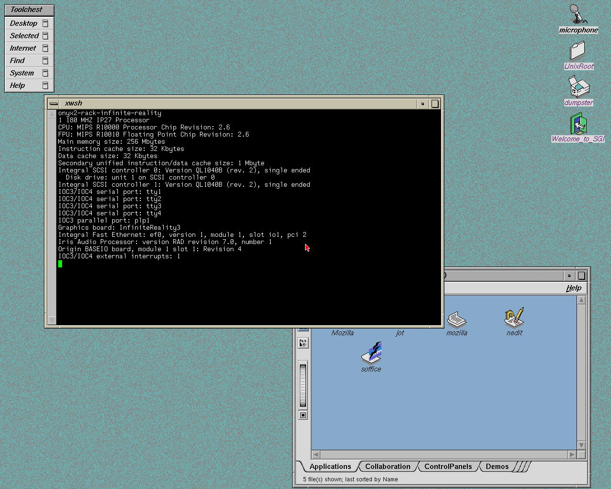

## Origin 2000 and Origin 200 with IMPACT (`origin2000-impact`, `origin200-impact`)

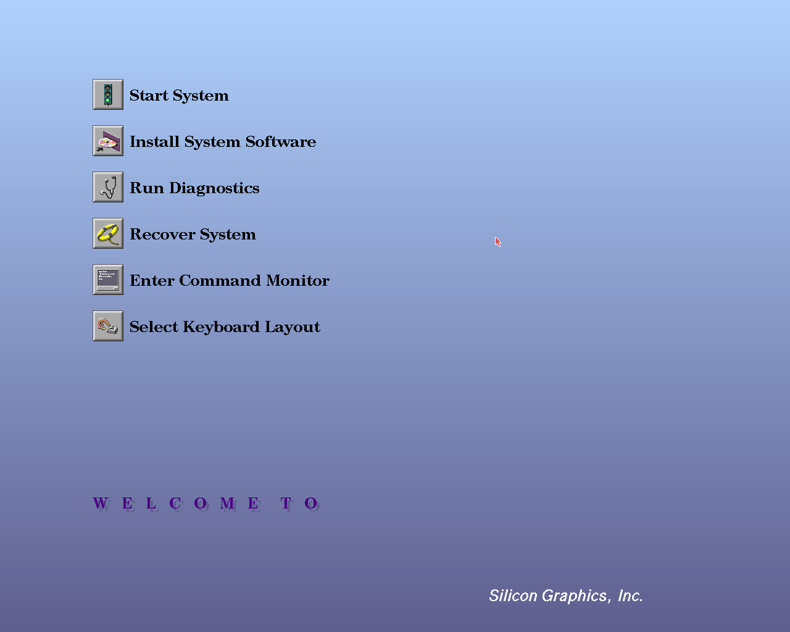
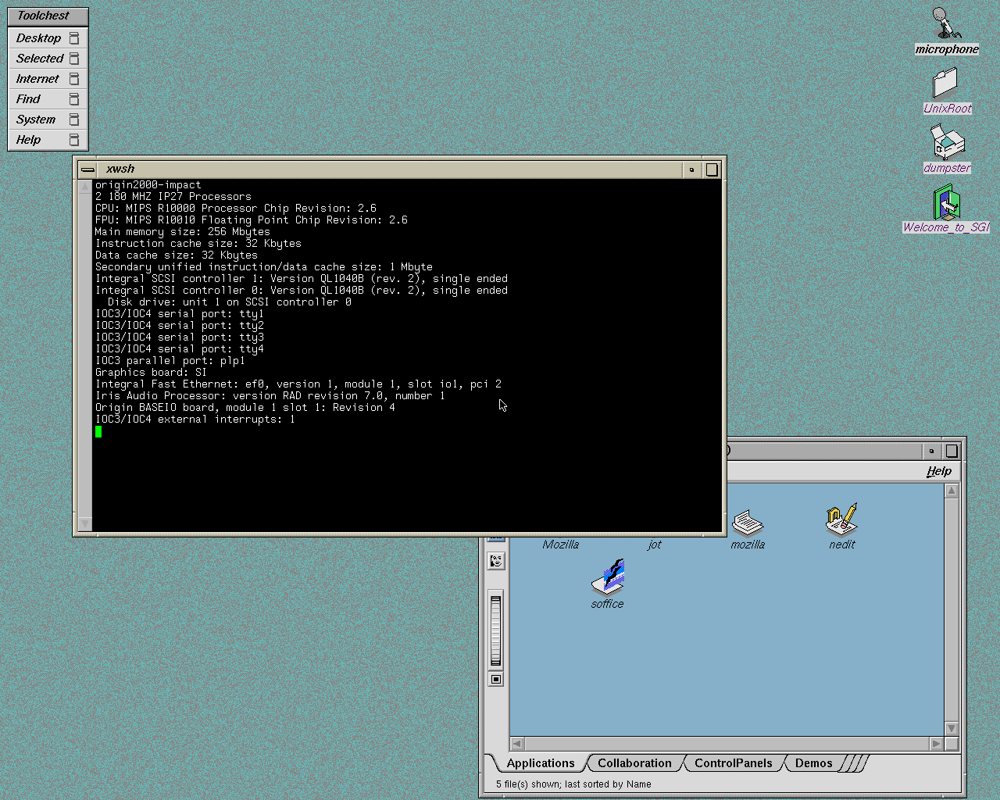


## Origin 200 with RAD4 (`origin200-rad4`)

The RAD4 card shows its own start-up screen; the PROM menu is on serial.


## Onyx 3000 and Onyx 3400 (`onyx3000-vpro`, `onyx3400-infinite-reality`)

The Onyx 3000 has a V-brick with one VPro V12 pipe.

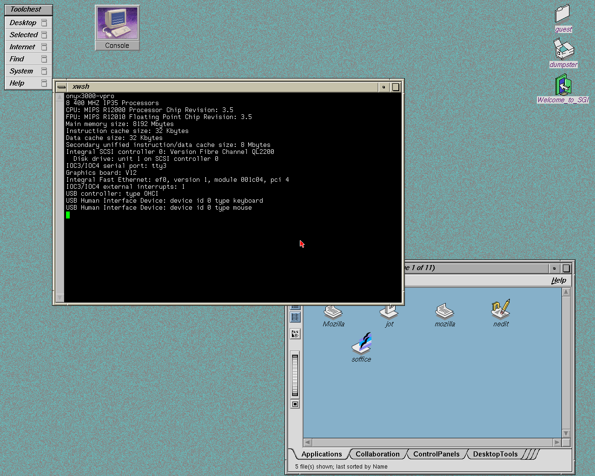

The Onyx 3400 takes up to four InfiniteReality3 pipes in two G-bricks
(`--graphics-pipes 4`). Each pipe is a separate X screen and its own console;
here are all four, one per quadrant:

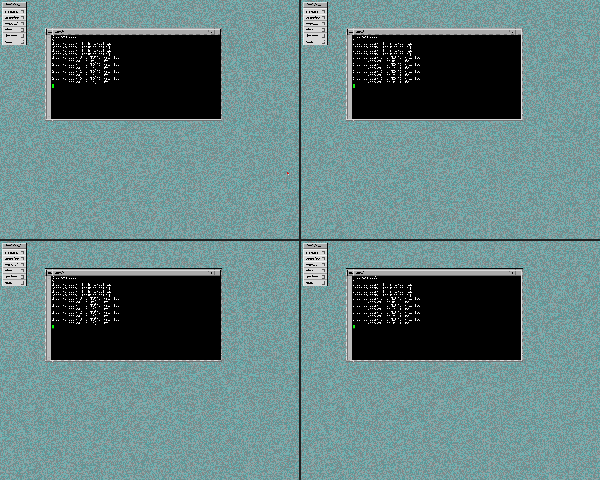

After `ircombine` stores a two-channel combination, the two heads of a pipe are
one 2560x1024 desktop. This is pipe 0 with `hinv` and `gfxinfo`, both heads side
by side:

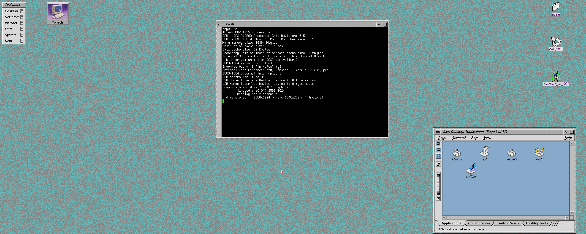

## Origin 3000 servers

The Origin 3200, 3400 and 3900 have no graphics. This is `hinv -v` from each,
booted from one IRIX 6.5.30 install.

### Origin 3200 (`origin3200`)

<details><summary>hinv -v</summary>

```
8 400 MHZ IP35 Processors
CPU: MIPS R12000 Processor Chip Revision: 3.5
FPU: MIPS R12010 Floating Point Chip Revision: 3.5
CPU 0 at Module 001c04/Slot 0/Slice A: 400 Mhz MIPS R12000 Processor Chip (enabled) 
  Processor revision: 3.5. Scache: Size 8 MB Speed 266 Mhz  Tap 0xa
CPU 1 at Module 001c04/Slot 0/Slice B: 400 Mhz MIPS R12000 Processor Chip (enabled) 
  Processor revision: 3.5. Scache: Size 8 MB Speed 266 Mhz  Tap 0xa
CPU 2 at Module 001c04/Slot 0/Slice C: 400 Mhz MIPS R12000 Processor Chip (enabled) 
  Processor revision: 3.5. Scache: Size 8 MB Speed 266 Mhz  Tap 0xa
CPU 3 at Module 001c04/Slot 0/Slice D: 400 Mhz MIPS R12000 Processor Chip (enabled) 
  Processor revision: 3.5. Scache: Size 8 MB Speed 266 Mhz  Tap 0xa
CPU 4 at Module 001c07/Slot 0/Slice A: 400 Mhz MIPS R12000 Processor Chip (enabled) 
  Processor revision: 3.5. Scache: Size 8 MB Speed 266 Mhz  Tap 0xa
CPU 5 at Module 001c07/Slot 0/Slice B: 400 Mhz MIPS R12000 Processor Chip (enabled) 
  Processor revision: 3.5. Scache: Size 8 MB Speed 266 Mhz  Tap 0xa
CPU 6 at Module 001c07/Slot 0/Slice C: 400 Mhz MIPS R12000 Processor Chip (enabled) 
  Processor revision: 3.5. Scache: Size 8 MB Speed 266 Mhz  Tap 0xa
CPU 7 at Module 001c07/Slot 0/Slice D: 400 Mhz MIPS R12000 Processor Chip (enabled) 
  Processor revision: 3.5. Scache: Size 8 MB Speed 266 Mhz  Tap 0xa
Main memory size: 8192 Mbytes
Instruction cache size: 32 Kbytes
Data cache size: 32 Kbytes
Secondary unified instruction/data cache size: 8 Mbytes
Memory at Module 001c04/Slot 0: 4096 MB (enabled)
  Bank 0 contains 512 MB (Premium) DIMMS (enabled)
  Bank 1 contains 512 MB (Premium) DIMMS (enabled)
  Bank 2 contains 512 MB (Premium) DIMMS (enabled)
  Bank 3 contains 512 MB (Premium) DIMMS (enabled)
  Bank 4 contains 512 MB (Premium) DIMMS (enabled)
  Bank 5 contains 512 MB (Premium) DIMMS (enabled)
  Bank 6 contains 512 MB (Premium) DIMMS (enabled)
  Bank 7 contains 512 MB (Premium) DIMMS (enabled)
Memory at Module 001c07/Slot 0: 4096 MB (enabled)
  Bank 0 contains 512 MB (Premium) DIMMS (enabled)
  Bank 1 contains 512 MB (Premium) DIMMS (enabled)
  Bank 2 contains 512 MB (Premium) DIMMS (enabled)
  Bank 3 contains 512 MB (Premium) DIMMS (enabled)
  Bank 4 contains 512 MB (Premium) DIMMS (enabled)
  Bank 5 contains 512 MB (Premium) DIMMS (enabled)
  Bank 6 contains 512 MB (Premium) DIMMS (enabled)
  Bank 7 contains 512 MB (Premium) DIMMS (enabled)
Integral SCSI controller 0: Version Fibre Channel QL2200, 33 MHz PCI
  Disk drive: unit 1 on SCSI controller 0 (unit 1)
IOC3/IOC4 serial port: tty3
Integral Fast Ethernet: ef0, version 1, module 001c04, pci 4
  PCI Adapter ID (vendor 0x1077, device 0x2200) PCI slot 1
  PCI Adapter ID (vendor 0x10a9, device 0x0003) PCI slot 4
  PCI Adapter ID (vendor 0x11c1, device 0x5802) PCI slot 5
IOC3/IOC4 external interrupts: 1
HUB in Module 001c04/Slot 0: Revision 2 Speed 200.00 Mhz (enabled)
HUB in Module 001c07/Slot 0: Revision 2 Speed 200.00 Mhz (enabled)
IP35prom in Module 001c04/Slot n0: Revision 6.210
IP35prom in Module 001c07/Slot n0: Revision 6.210
USB controller: type OHCI
USB Human Interface Device: device id 0 type keyboard
USB Human Interface Device: device id 0 type mouse
```

</details>

### Origin 3400 (`origin3400`)

<details><summary>hinv -v</summary>

```
16 400 MHZ IP35 Processors
CPU: MIPS R12000 Processor Chip Revision: 3.5
FPU: MIPS R12010 Floating Point Chip Revision: 3.5
CPU 0 at Module 001c04/Slot 0/Slice A: 400 Mhz MIPS R12000 Processor Chip (enabled) 
  Processor revision: 3.5. Scache: Size 8 MB Speed 266 Mhz  Tap 0xa
CPU 1 at Module 001c04/Slot 0/Slice B: 400 Mhz MIPS R12000 Processor Chip (enabled) 
  Processor revision: 3.5. Scache: Size 8 MB Speed 266 Mhz  Tap 0xa
CPU 2 at Module 001c04/Slot 0/Slice C: 400 Mhz MIPS R12000 Processor Chip (enabled) 
  Processor revision: 3.5. Scache: Size 8 MB Speed 266 Mhz  Tap 0xa
CPU 3 at Module 001c04/Slot 0/Slice D: 400 Mhz MIPS R12000 Processor Chip (enabled) 
  Processor revision: 3.5. Scache: Size 8 MB Speed 266 Mhz  Tap 0xa
CPU 4 at Module 001c07/Slot 0/Slice A: 400 Mhz MIPS R12000 Processor Chip (enabled) 
  Processor revision: 3.5. Scache: Size 8 MB Speed 266 Mhz  Tap 0xa
CPU 5 at Module 001c07/Slot 0/Slice B: 400 Mhz MIPS R12000 Processor Chip (enabled) 
  Processor revision: 3.5. Scache: Size 8 MB Speed 266 Mhz  Tap 0xa
CPU 6 at Module 001c07/Slot 0/Slice C: 400 Mhz MIPS R12000 Processor Chip (enabled) 
  Processor revision: 3.5. Scache: Size 8 MB Speed 266 Mhz  Tap 0xa
CPU 7 at Module 001c07/Slot 0/Slice D: 400 Mhz MIPS R12000 Processor Chip (enabled) 
  Processor revision: 3.5. Scache: Size 8 MB Speed 266 Mhz  Tap 0xa
CPU 8 at Module 001c10/Slot 0/Slice A: 400 Mhz MIPS R12000 Processor Chip (enabled) 
  Processor revision: 3.5. Scache: Size 8 MB Speed 266 Mhz  Tap 0xa
CPU 9 at Module 001c10/Slot 0/Slice B: 400 Mhz MIPS R12000 Processor Chip (enabled) 
  Processor revision: 3.5. Scache: Size 8 MB Speed 266 Mhz  Tap 0xa
CPU 10 at Module 001c10/Slot 0/Slice C: 400 Mhz MIPS R12000 Processor Chip (enabled) 
  Processor revision: 3.5. Scache: Size 8 MB Speed 266 Mhz  Tap 0xa
CPU 11 at Module 001c10/Slot 0/Slice D: 400 Mhz MIPS R12000 Processor Chip (enabled) 
  Processor revision: 3.5. Scache: Size 8 MB Speed 266 Mhz  Tap 0xa
CPU 12 at Module 001c13/Slot 0/Slice A: 400 Mhz MIPS R12000 Processor Chip (enabled) 
  Processor revision: 3.5. Scache: Size 8 MB Speed 266 Mhz  Tap 0xa
CPU 13 at Module 001c13/Slot 0/Slice B: 400 Mhz MIPS R12000 Processor Chip (enabled) 
  Processor revision: 3.5. Scache: Size 8 MB Speed 266 Mhz  Tap 0xa
CPU 14 at Module 001c13/Slot 0/Slice C: 400 Mhz MIPS R12000 Processor Chip (enabled) 
  Processor revision: 3.5. Scache: Size 8 MB Speed 266 Mhz  Tap 0xa
CPU 15 at Module 001c13/Slot 0/Slice D: 400 Mhz MIPS R12000 Processor Chip (enabled) 
  Processor revision: 3.5. Scache: Size 8 MB Speed 266 Mhz  Tap 0xa
Main memory size: 16384 Mbytes
Instruction cache size: 32 Kbytes
Data cache size: 32 Kbytes
Secondary unified instruction/data cache size: 8 Mbytes
Memory at Module 001c04/Slot 0: 4096 MB (enabled)
  Bank 0 contains 512 MB (Premium) DIMMS (enabled)
  Bank 1 contains 512 MB (Premium) DIMMS (enabled)
  Bank 2 contains 512 MB (Premium) DIMMS (enabled)
  Bank 3 contains 512 MB (Premium) DIMMS (enabled)
  Bank 4 contains 512 MB (Premium) DIMMS (enabled)
  Bank 5 contains 512 MB (Premium) DIMMS (enabled)
  Bank 6 contains 512 MB (Premium) DIMMS (enabled)
  Bank 7 contains 512 MB (Premium) DIMMS (enabled)
Memory at Module 001c07/Slot 0: 4096 MB (enabled)
  Bank 0 contains 512 MB (Premium) DIMMS (enabled)
  Bank 1 contains 512 MB (Premium) DIMMS (enabled)
  Bank 2 contains 512 MB (Premium) DIMMS (enabled)
  Bank 3 contains 512 MB (Premium) DIMMS (enabled)
  Bank 4 contains 512 MB (Premium) DIMMS (enabled)
  Bank 5 contains 512 MB (Premium) DIMMS (enabled)
  Bank 6 contains 512 MB (Premium) DIMMS (enabled)
  Bank 7 contains 512 MB (Premium) DIMMS (enabled)
Memory at Module 001c10/Slot 0: 4096 MB (enabled)
  Bank 0 contains 512 MB (Premium) DIMMS (enabled)
  Bank 1 contains 512 MB (Premium) DIMMS (enabled)
  Bank 2 contains 512 MB (Premium) DIMMS (enabled)
  Bank 3 contains 512 MB (Premium) DIMMS (enabled)
  Bank 4 contains 512 MB (Premium) DIMMS (enabled)
  Bank 5 contains 512 MB (Premium) DIMMS (enabled)
  Bank 6 contains 512 MB (Premium) DIMMS (enabled)
  Bank 7 contains 512 MB (Premium) DIMMS (enabled)
Memory at Module 001c13/Slot 0: 4096 MB (enabled)
  Bank 0 contains 512 MB (Premium) DIMMS (enabled)
  Bank 1 contains 512 MB (Premium) DIMMS (enabled)
  Bank 2 contains 512 MB (Premium) DIMMS (enabled)
  Bank 3 contains 512 MB (Premium) DIMMS (enabled)
  Bank 4 contains 512 MB (Premium) DIMMS (enabled)
  Bank 5 contains 512 MB (Premium) DIMMS (enabled)
  Bank 6 contains 512 MB (Premium) DIMMS (enabled)
  Bank 7 contains 512 MB (Premium) DIMMS (enabled)
ROUTER in Module 001c04/Slot 0: Revision 1: Active Ports [2,3,4,5,] (enabled)
Integral SCSI controller 0: Version Fibre Channel QL2200, 33 MHz PCI
  Disk drive: unit 1 on SCSI controller 0 (unit 1)
IOC3/IOC4 serial port: tty3
Integral Fast Ethernet: ef0, version 1, module 001c04, pci 4
  PCI Adapter ID (vendor 0x1077, device 0x2200) PCI slot 1
  PCI Adapter ID (vendor 0x10a9, device 0x0003) PCI slot 4
  PCI Adapter ID (vendor 0x11c1, device 0x5802) PCI slot 5
IOC3/IOC4 external interrupts: 1
HUB in Module 001c04/Slot 0: Revision 2 Speed 200.00 Mhz (enabled)
HUB in Module 001c07/Slot 0: Revision 2 Speed 200.00 Mhz (enabled)
HUB in Module 001c10/Slot 0: Revision 2 Speed 200.00 Mhz (enabled)
HUB in Module 001c13/Slot 0: Revision 2 Speed 200.00 Mhz (enabled)
IP35prom in Module 001c04/Slot n0: Revision 6.210
IP35prom in Module 001c07/Slot n0: Revision 6.210
IP35prom in Module 001c10/Slot n0: Revision 6.210
IP35prom in Module 001c13/Slot n0: Revision 6.210
USB controller: type OHCI
USB Human Interface Device: device id 0 type keyboard
USB Human Interface Device: device id 0 type mouse
```

</details>

### Origin 3900 (`origin3900`)

<details><summary>hinv -v</summary>

```
16 700 MHZ IP35 Processors
CPU: MIPS R16000 Processor Chip Revision: 3.0
FPU: MIPS R16010 Floating Point Chip Revision: 3.0
CPU 0 at Module 001c07/Slot 0/Slice A: 700 Mhz MIPS R16000 Processor Chip (enabled) 
  Processor revision: 3.0. Scache: Size 8 MB Speed 350 Mhz  Tap 0xb
CPU 1 at Module 001c07/Slot 0/Slice B: 700 Mhz MIPS R16000 Processor Chip (enabled) 
  Processor revision: 3.0. Scache: Size 8 MB Speed 350 Mhz  Tap 0xb
CPU 2 at Module 001c07/Slot 0/Slice C: 700 Mhz MIPS R16000 Processor Chip (enabled) 
  Processor revision: 3.0. Scache: Size 8 MB Speed 350 Mhz  Tap 0xb
CPU 3 at Module 001c07/Slot 0/Slice D: 700 Mhz MIPS R16000 Processor Chip (enabled) 
  Processor revision: 3.0. Scache: Size 8 MB Speed 350 Mhz  Tap 0xb
CPU 4 at Module 001c08/Slot 0/Slice A: 700 Mhz MIPS R16000 Processor Chip (enabled) 
  Processor revision: 3.0. Scache: Size 8 MB Speed 350 Mhz  Tap 0xb
CPU 5 at Module 001c08/Slot 0/Slice B: 700 Mhz MIPS R16000 Processor Chip (enabled) 
  Processor revision: 3.0. Scache: Size 8 MB Speed 350 Mhz  Tap 0xb
CPU 6 at Module 001c08/Slot 0/Slice C: 700 Mhz MIPS R16000 Processor Chip (enabled) 
  Processor revision: 3.0. Scache: Size 8 MB Speed 350 Mhz  Tap 0xb
CPU 7 at Module 001c08/Slot 0/Slice D: 700 Mhz MIPS R16000 Processor Chip (enabled) 
  Processor revision: 3.0. Scache: Size 8 MB Speed 350 Mhz  Tap 0xb
CPU 8 at Module 001c09/Slot 0/Slice A: 700 Mhz MIPS R16000 Processor Chip (enabled) 
  Processor revision: 3.0. Scache: Size 8 MB Speed 350 Mhz  Tap 0xb
CPU 9 at Module 001c09/Slot 0/Slice B: 700 Mhz MIPS R16000 Processor Chip (enabled) 
  Processor revision: 3.0. Scache: Size 8 MB Speed 350 Mhz  Tap 0xb
CPU 10 at Module 001c09/Slot 0/Slice C: 700 Mhz MIPS R16000 Processor Chip (enabled) 
  Processor revision: 3.0. Scache: Size 8 MB Speed 350 Mhz  Tap 0xb
CPU 11 at Module 001c09/Slot 0/Slice D: 700 Mhz MIPS R16000 Processor Chip (enabled) 
  Processor revision: 3.0. Scache: Size 8 MB Speed 350 Mhz  Tap 0xb
CPU 12 at Module 001c10/Slot 0/Slice A: 700 Mhz MIPS R16000 Processor Chip (enabled) 
  Processor revision: 3.0. Scache: Size 8 MB Speed 350 Mhz  Tap 0xb
CPU 13 at Module 001c10/Slot 0/Slice B: 700 Mhz MIPS R16000 Processor Chip (enabled) 
  Processor revision: 3.0. Scache: Size 8 MB Speed 350 Mhz  Tap 0xb
CPU 14 at Module 001c10/Slot 0/Slice C: 700 Mhz MIPS R16000 Processor Chip (enabled) 
  Processor revision: 3.0. Scache: Size 8 MB Speed 350 Mhz  Tap 0xb
CPU 15 at Module 001c10/Slot 0/Slice D: 700 Mhz MIPS R16000 Processor Chip (enabled) 
  Processor revision: 3.0. Scache: Size 8 MB Speed 350 Mhz  Tap 0xb
Main memory size: 8192 Mbytes
Instruction cache size: 32 Kbytes
Data cache size: 32 Kbytes
Secondary unified instruction/data cache size: 8 Mbytes
Memory at Module 001c07/Slot 0: 2048 MB (enabled)
  Bank 0 contains 1024 MB (Premium) DIMMS (enabled)
  Bank 1 contains 1024 MB (Premium) DIMMS (enabled)
Memory at Module 001c08/Slot 0: 2048 MB (enabled)
  Bank 0 contains 1024 MB (Premium) DIMMS (enabled)
  Bank 1 contains 1024 MB (Premium) DIMMS (enabled)
Memory at Module 001c09/Slot 0: 2048 MB (enabled)
  Bank 0 contains 1024 MB (Premium) DIMMS (enabled)
  Bank 1 contains 1024 MB (Premium) DIMMS (enabled)
Memory at Module 001c10/Slot 0: 2048 MB (enabled)
  Bank 0 contains 1024 MB (Premium) DIMMS (enabled)
  Bank 1 contains 1024 MB (Premium) DIMMS (enabled)
ROUTER in Module 001c07/Slot 0: Revision 1: Active Ports [2,3,4,5,] (enabled)
Integral SCSI controller 0: Version Fibre Channel QL2200, 33 MHz PCI
  Disk drive: unit 1 on SCSI controller 0 (unit 1)
IOC3/IOC4 serial port: tty4
Integral Fast Ethernet: ef0, version 1, module 001c07, pci 4
  PCI Adapter ID (vendor 0x1077, device 0x2200) PCI slot 1
  PCI Adapter ID (vendor 0x10a9, device 0x0003) PCI slot 4
  PCI Adapter ID (vendor 0x11c1, device 0x5802) PCI slot 5
IOC3/IOC4 external interrupts: 1
HUB in Module 001c07/Slot 0: Revision 2 Speed 200.00 Mhz (enabled)
HUB in Module 001c08/Slot 0: Revision 2 Speed 200.00 Mhz (enabled)
HUB in Module 001c09/Slot 0: Revision 2 Speed 200.00 Mhz (enabled)
HUB in Module 001c10/Slot 0: Revision 2 Speed 200.00 Mhz (enabled)
IP35prom in Module 001c07/Slot n0: Revision 6.210
IP35prom in Module 001c08/Slot n0: Revision 6.210
IP35prom in Module 001c09/Slot n0: Revision 6.210
IP35prom in Module 001c10/Slot n0: Revision 6.210
USB controller: type OHCI
USB Human Interface Device: device id 1 type keyboard
USB Human Interface Device: device id 1 type mouse
```

</details>
