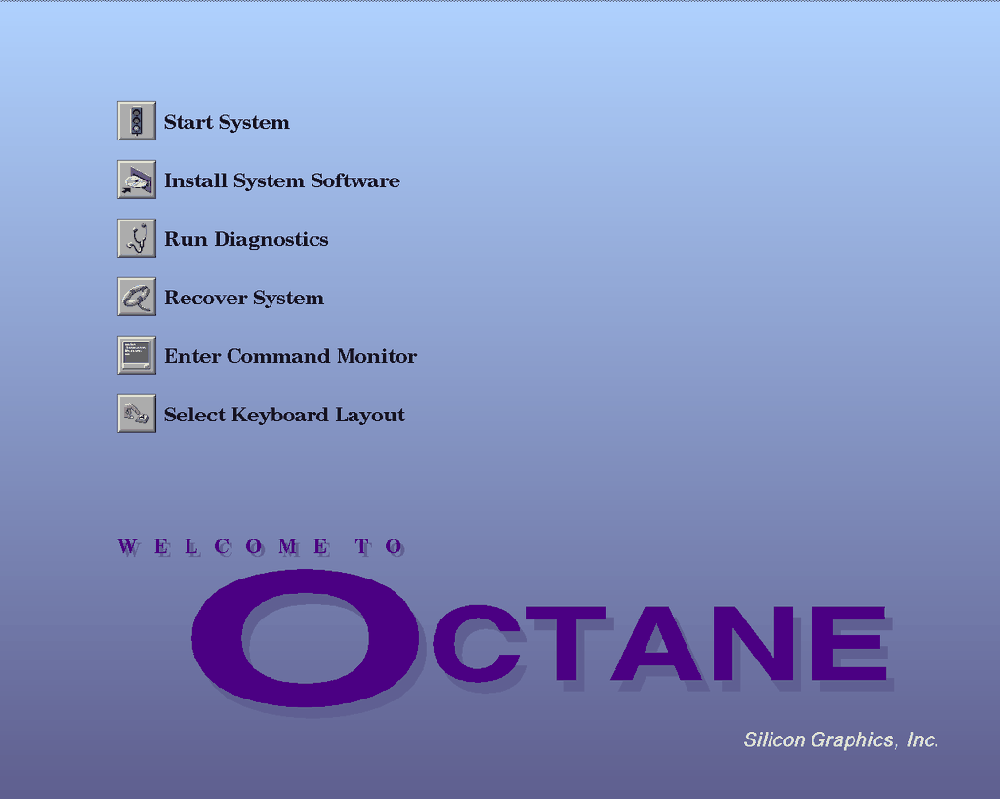
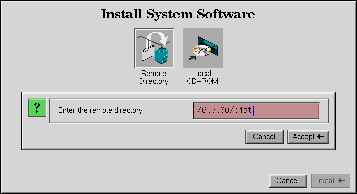
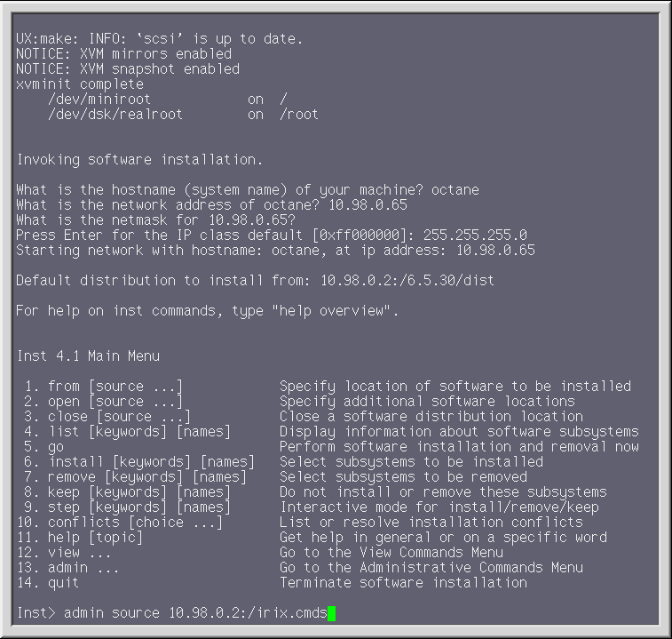
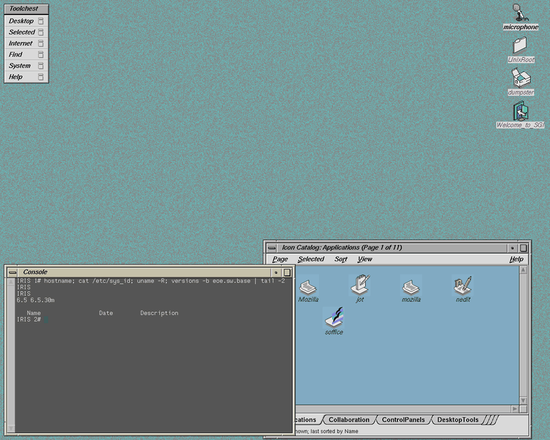

# Using Origami

[Back to the README](../README.md)

This guide follows a first session: install the archive, pick a machine,
create it, start it, install IRIX, then set up networking and graphics.
Examples use version 0.4.1. Substitute the version you downloaded.

## Install the archive

Download the archive for your host from the
[release page](https://github.com/jamesbraid/origami/releases) and extract
it:

```sh
tar -xzf origami-0.4.1-linux-x86_64.tar.gz      # Linux
tar -xzf origami-0.4.1-macos-arm64.tar.gz       # macOS, Apple Silicon
```

```powershell
Expand-Archive .\origami-0.4.1-windows-x86_64.zip -DestinationPath .\origami
```

Keep the extracted directory whole. The CLI needs the QEMU, Instigator and
data files packed beside it. Add its `bin` directory to your PATH, or use the
full path wherever this guide says `origami`. To try a newer version, extract
it into a separate directory and keep machine directories, firmware and disk
images outside the package.

`origami --help` lists every command. `origami COMMAND --help` shows a
command's options and an example.

## List machines

```sh
origami machines
```

This lists the starter presets with each one's machine, CPU count and
graphics. `origami machines PRESET` shows one preset in detail: its memory,
every board it takes and the slots, what it refuses and why, and the
processor modules of an Origin 200. `origami machines --all` shows them all.

| Preset | Machine | Graphics |
|---|---|---|
| `origin200-1`, `origin200-2` | Origin 200, 1 or 2 CPUs | none |
| `origin200-dual` | Origin 200, two chassis, 4 CPUs | none |
| `origin200-rad4` | Origin 200, 2 CPUs | PsiTech RAD4 |
| `origin200-impact` | Origin 200 GIGAchannel | SI |
| `origin2000-8` | Origin 2000 rack, 8 CPUs | none |
| `origin2000-impact` | Origin 2000 deskside, 2 CPUs | SI |
| `origin300-2` | Origin 300, 2 CPUs | none |
| `origin3200` | Origin 3200, two C-bricks, 8 CPUs | none |
| `origin3400` | Origin 3400, four C-bricks, 16 CPUs | none |
| `origin3900` | Origin 3900, one Cx-brick, 16 CPUs | none |
| `onyx3000-vpro` | Onyx 3000, two C-bricks, 8 CPUs | VPro V12 |
| `onyx3400-infinite-reality` | Onyx 3400, four C-bricks, 16 CPUs | InfiniteReality3 |
| `octane-impact` | Octane | SI |
| `octane2-impact` | Octane2 | SI |
| `octane2-vpro` | Octane2 | VPro V12 |
| `onyx2-infinite-reality` | Onyx2 deskside, 4 CPUs | InfiniteReality2 |
| `onyx2-rack-infinite-reality` | Onyx2 rack, 1 CPU | InfiniteReality3 |
| `fuel-1` | Fuel | VPro V12 |
| `onyx350-vpro` | Onyx 350, 4 CPUs | VPro V12 |
| `tezro-vpro` | Tezro tower, 4 CPUs | VPro V12 |

## Create a machine

```sh
origami create my-origin --preset octane2-vpro
```

This makes a directory called `my-origin` holding `machine.toml` and the
machine's flash and NVRAM. The first `create` for a preset downloads its
PROM over HTTPS and checks its size and SHA-256. Verified PROMs are cached
in your user cache directory, so later creates work offline. To use your
own PROM file instead:

```sh
origami create my-origin --preset octane2-vpro --prom prom.img
```

Presets with a BaseIO or GIGAchannel board, such as the Origin 2000 and
Onyx2, also need an IO PROM. `--io-prom FILE` supplies a local one.

Common options:

- `--memory-per-node MiB` sets memory per node. A size the machine does not
  take is refused with the list of sizes it does.
- `--processor ID` picks an Origin 200 processor module, such as
  `r12000-270mhz-4mb`. `origami machines PRESET` lists them.
- `--graphics`, `--graphics-slot` and `--graphics-setting` change the
  graphics. See [Graphics](#graphics).
- `--mac 08:00:69:12:34:56` sets the machine's Ethernet address. Without it,
  `create` picks a unique SGI one.

```sh
origami create my-o200 --preset origin200-2 --processor r12000-270mhz-4mb
origami create my-onyx2 --preset onyx2-infinite-reality --graphics-setting rm-count=1
```

### Add a disk

Give a new machine an empty system disk, size in MiB:

```sh
origami drive-create my-origin 4096
```

Or attach a copy of an existing IRIX disk as the system disk. Use a disk
prepared for the same kind of machine. The guest writes to it, so keep the
original safe.

An Origin 3000 disk installed on one Origin 3000 preset boots on the others.
A new machine stops at the PROM menu, so run `origami nvram DIR set
AutoLoad=Yes` to start the disk without a keypress.

```sh
origami drive-attach my-origin /path/to/copied-guest-disk.qcow2 --type disk --target 1
```

CD-ROM and tape images attach the same way. `drive-detach` removes the
attachment and leaves the image file in place.

```sh
origami drive-attach my-origin /path/to/irix-install.iso --type cdrom --target 4
origami drive-attach my-origin /path/to/tape.image --type tape --target 5
origami drive-detach my-origin cdrom4
```

Stop the machine before changing its drives.

## Run it

```sh
origami run my-origin
```

A foreground run uses your terminal as the serial console and opens a
window for any graphics. Other display choices:

```sh
origami run my-origin --display vnc --vnc-port 5991
origami run my-origin --display none
```

A background run returns to the shell and keeps the machine going:

```sh
origami run my-origin --display none --background
origami status my-origin
origami console my-origin
origami stop my-origin
```

`console` attaches to the background run's serial console, and `stop` asks
QEMU to quit. Both need a background run. Every run appends the serial
output to `my-origin/logs/serial.log`. A machine runs only once at a time.
A second launch is refused.

On a cold start an installed guest boots straight to IRIX. Press Esc while
the PROM prints "Starting up the system" to stop at its System Maintenance
Menu instead.

`origami validate my-origin` checks the configuration without starting it.
`origami show my-origin` prints it. `origami show-command my-origin` prints
the QEMU command a run would use.

## Install IRIX

Origami installs IRIX 6.5.30 over a private network from Instigator, a
server bundled in the archive. The media download from a public archive as
needed. You drive the PROM, disk formatter and installer yourself, on the
machine's console.

The Origin 3000 presets install the same way over their serial console.
`onyx3000-vpro` and `onyx3400-infinite-reality` start their PROM on serial.
To install on the graphics console, run `origami nvram DIR set console=g`
first. The steps use an Octane2 with VPro graphics, whose PROM and installer
run in the machine's window. `origin200-rad4` has no PROM console on its RAD4
card, so it installs over the serial console and uses RAD4 once X starts.
Type the same commands in this terminal instead of the window. On a serial
console, PROM menu numbers need Enter.

### 1. Prepare

Start from a stopped machine with an empty system disk:

```sh
origami create my-octane --preset octane2-vpro
origami drive-create my-octane 4096
origami install-init my-octane
origami install-check my-octane
```

`install-init` writes the media list to `my-octane/install/media.toml` and
switches the machine to the private installation network. `install-check`
opens no network ports. It assembles local media in full and sends each
remote URL one HEAD request, reporting every URL that does not answer.
`install-check --full` also reads the remote media, as `install-serve` does
at start.

- `--profile standard`, the default, installs all ten IRIX 6.5.30 discs.
  `--profile minimal` installs the six overlay, foundation and NFS discs.
- `--release 6.5.22` installs IRIX 6.5.22 instead, standard profile only. Use
  `6.5.22` where this guide says `6.5.30`, in paths and `--media-root`.
- `--media-root DIR` reads local discs from `DIR/6.5.30/` and
  `DIR/6.5-base/`, named `.image`.

### 2. Add optional packages

Add-ons install after IRIX. Stop the machine before changing them.

```sh
origami install-addon my-octane --name mipspro
origami install-addon my-octane --name tablet --source /path/to/tablet.tardist --install PRODUCT.SUBSYSTEM
```

`mipspro` is the MIPSpro 7.4.4 compiler update from the public archive,
for the standard profile. `--source` takes a local SGI image, extracted
tree, `.tar`, `.tar.gz`, `.tgz`, `.tardist` or `.tardist.gz`, or an HTTPS
URL. Repeat `--install` for each package selection.

### 3. Serve and boot

```sh
origami install-serve my-octane      # leave running in its own terminal
origami run my-octane                # second terminal
```

`install-serve` logs to `server.log` in `my-octane/install/instigator-*/`.
The server is `10.98.0.2`. It gives the machine `10.98.0.65` by bootp.

A new Octane2 tries to boot the blank disk and stops at `Unable to boot;
press any key to continue:`. Press a key for the System Maintenance Menu.
The graphical menu shows no numbers, but the number keys work.



### 4. Label the disk

Press `5` for the Command Monitor, then start the disk formatter:

```text
boot -f bootp():/6.5.30/stand/fx.64
```

Press Enter at each of `fx`'s four prompts: extended mode, device name,
controller and drive. It builds a default label. Then type
`exit` and press Enter at `write out changes? (yes)`. This erases the disk.

### 5. Start the installer

At the menu, press `2` for **Install System Software**, then `1` for
**Remote Directory**. Enter the host `10.98.0.2` and the directory
`/6.5.30/dist`, then press Enter to activate **Install**.



The miniroot loads and asks:

- make a new file system: `yes`, then `y`
- block size: `4096`
- hostname and address `10.98.0.65`, then netmask `255.255.255.0` if it asks

These apply to the miniroot only. The installed system takes its address
from DHCP. The miniroot stops at `Inst>`.

### 6. Install the packages

```text
Inst> admin source 10.98.0.2:/irix.cmds
```



The release notes scroll for a while. At the numbered menu ending in
`Install software from:`, type `done`. The script then selects the
packages, including every configured add-on, and runs `go`. Wait for:

```text
instigator: post-install commands finished
```

Then type `quit`. Relinking the kernel takes a few minutes. At
`Restart? { (y)es, (n)o, (sh)ell, (h)elp }:` answer `y`.

If `inst` reports a conflict or a failed command, the line above never
appears. Read the output and resolve it at `Inst>`.

The first boot reaches the graphical login. `root` has no password. The 4Dwm
window manager gives keyboard focus to the window under the pointer.



> **Automated install (serial console only).** `install-apply` types step
> 6 for you. Start the machine with a background run, do steps 4 and 5
> through `origami console`, disconnect at `Inst>`, then run
> `origami install-apply my-octane` from another terminal. It stops and
> leaves the guest running on a conflict or failed command.
>
> ```sh
> origami run my-octane --display none --background
> origami console my-octane
> ```

### 7. After installation

Shut IRIX down as root with `halt -p`, then stop the machine: close
its window, press Ctrl-C in a foreground run, or run `origami stop
my-octane`. Switch it back to QEMU's user networking and start it again:

```sh
origami network-set my-octane --mode user
origami run my-octane
```

The guest gets its address, route and DNS server from QEMU by DHCP and
takes its hostname from the machine directory's name when that is valid.
It boots straight to IRIX on every start. To make the PROM wait at its
menu, run `nvram AutoLoad No` as root, or use `origami nvram` below.

A RAD4 guest boots to PsiTech's unbuffered X server. As root,
`chkconfig rad4X_buffered_server on` selects the buffered server, and
`chkconfig rad4X_usekm_devs on` selects a RAD4-KM keyboard and mouse.

## Networking

A machine starts with QEMU's user networking: the guest can reach out, and
nothing reaches in unless you forward a port. Stop the machine before
changing its network or forwards.

Every network Origami gives a guest is `10.98.0.0/24`. The host and DHCP
server are `10.98.0.2` and the guest is `10.98.0.65`. User networking adds
a DNS server at `10.98.0.3`. A guest moved between modes keeps its address.

To use another private /24, such as when `10.98.0.0/24` clashes with a VPN,
run `origami network-set my-origin --mode user --subnet 10.42.0.0/24`. The
host, DNS server, share stack and guest take `.2`, `.3`, `.4` and `.65` of
it, in user and private modes and in installs, and a later `network-set`
keeps it. A guest that booted on the old subnet keeps its old address until
you run `rm /var/adm/proclaim.lease_info* /etc/resolv.conf` as root in IRIX,
once, and restart it. Leave `resolv.conf` behind and the old DNS server in it
can stop IRIX's name service starting, so lookups fail until the next restart.

### Forward a port

```sh
origami network-forward-add my-origin ssh --protocol tcp --host-port 2222 --guest-port 22
origami network-forward-remove my-origin ssh
```

Forwards listen on the host's loopback address only and reach the guest at
`10.98.0.65`. They work in user mode, and are kept but inactive in the
other modes.

### Share a host folder

```sh
origami share my-octane src ~/code
origami run my-octane
```

`share` prints the commands to run as root in IRIX, once the guest is up
with `nfs.sw.nfs` installed:

```sh
mkdir -p /mnt/src
mount 10.98.0.4:/src /mnt/src
```

Guest files are owned by root and land on the host as you. Remove a share
with `origami share my-octane src --remove`. Shares work in user, private,
tap and vmnet modes. On tap and vmnet, add `--share-address ADDRESS/PREFIX`
to `network-set`: a free address on that network. User and private networks
serve shares at `10.98.0.4`, and a private network at `10.98.0.2` as well.

A private network with no `--endpoint`, or none listening, is hosted by
`run` itself: the guest gets `10.98.0.65` by DHCP, and the network has no
route out.

### Join a real network

To put the guest on your LAN, connect it to a host network device. The
guest then gets its own address from that network's DHCP server or by
hand.
Origami needs no administrator rights, but the host device must be created
once, as an administrator, beforehand.

```sh
origami network-set my-origin --mode tap --interface tap0                    # Linux
origami network-set my-origin --mode tap --interface "OpenVPN TAP-Windows6"  # Windows
origami network-set my-origin --mode vmnet --endpoint /opt/homebrew/var/run/socket_vmnet  # macOS
```

- **Linux:** create a tap device owned by your user and add it to a bridge
  that holds the host's Ethernet interface:
  `sudo ip tuntap add dev tap0 mode tap user $USER` then
  `sudo ip link set tap0 master br0 up`. How to set up `br0` depends on
  your distribution's network manager. See the
  [QEMU networking documentation](https://wiki.qemu.org/Documentation/Networking#Tap).
  Each running machine needs its own tap device.
- **Windows:** install a TAP-Windows6 adapter, from OpenVPN or
  [tap-windows6](https://github.com/OpenVPN/tap-windows6), as an
  administrator. `--interface` is the adapter's name in Network
  Connections. Use Bridge Connections there to join it to the LAN. To run
  without administrator rights, set the adapter's Non-Admin Access property
  to Allowed.
- **macOS:** install and start
  [socket_vmnet](https://github.com/lima-vm/socket_vmnet):
  `brew install socket_vmnet && sudo brew services start socket_vmnet`.
  `--endpoint` is its socket. The default socket gives a shared NAT subnet.
  socket_vmnet's bridged mode gives a socket such as
  `socket_vmnet.bridged.en0` that joins the LAN. `run` refuses to start if
  nothing answers on the socket.

Tap mode is not available on macOS, and vmnet mode is macOS only. If QEMU
cannot open the device, `run` shows QEMU's message and a hint.

`--mode none` disconnects the machine.

## Graphics

Each preset comes with its graphics, and `create` can choose others.
`origami machines PRESET` lists what each machine takes, which settings a board
leaves open, and what QEMU only approximates.

- `--graphics PRODUCT` picks a board, such as `si`, `esi`, `v12`, `ir2`,
  `ir3` or `rad4`, or `none` for no graphics.
- `--graphics-slot SLOT` puts it in another slot, such as `io5` on an
  Origin 2000 or `widget-9` on an Octane.
- `--graphics-setting NAME=VALUE`, repeatable, changes one board setting,
  such as `rm-count=1` or `display=dg5-2` for InfiniteReality.

```sh
origami create my-octane --preset octane-impact --graphics esi --graphics-slot widget-9
origami create my-onyx2 --preset onyx2-infinite-reality --graphics ir2 \
  --graphics-setting geometry=ge14-2 --graphics-setting display=dg5-2
```

A refused choice prints the reason, such as four raster managers on an
Onyx2 deskside or a V12 in an Octane. Onyx2 and Fuel always have graphics.
The Origin 200 and Origin 2000 are headless unless you choose a board. The
Origin 300, 3200, 3400 and 3900 offer no graphics.

Graphics are fixed once the machine exists. To try other graphics, create a
new machine and attach the old machine's disk.

### Which serial line is the console

`origami console` and a foreground run use the machine's console serial
line. That is the L1 on Origin 300, Origin 3000, Onyx 3000, Onyx 350, Tezro and Fuel, and IOC3 port
A on the others. On a machine with graphics, the PROM and IRIX may use the
graphics head as the console instead, and the serial line stays quiet.

A Fuel whose PROM has `console=d` set talks on IOC3 port A. Choose the line
while the machine is stopped:

```sh
origami console-set my-fuel --port ioc3_a
origami console-set my-fuel
```

The second form returns to the default. An unknown name lists the lines the
machine has.

## Upgrading a machine

A machine made by an older release must be upgraded once before other
commands accept it. Stop the machine, then run the new release's CLI:

```sh
origami upgrade my-origin
```

The upgrade keeps flash, NVRAM, drives, network settings and the MAC. A
machine that needs its PROMs to build a new state file downloads them as
`create` does, or takes local copies with `--prom FILE` and `--io-prom FILE`.
Running it on a current machine changes nothing. A machine that cannot be
upgraded is left untouched with the reason. Create a new machine and attach
the old disk.

## Working around a problem

`origami show-command DIR` prints the full QEMU command on one line, ready to
copy, edit and run. To append options instead, add them to `machine.toml`:

```toml
[qemu]
extra-args = ["-d", "guest_errors", "-D", "qemu.log"]
```

or pass them for one run with `--qemu-arg`, also accepted by `show-command`:

```sh
origami run my-onyx --qemu-arg=-d --qemu-arg=guest_errors
```

They go after Origami's own options. `-name`, `-qmp`, `-serial` and the
console `-chardev` are refused.

## PROM environment

`origami nvram` reads and changes the PROM's environment while the machine is
stopped. Boot the machine once first so the PROM writes its defaults.

```sh
origami nvram my-octane                    # list
origami nvram my-octane get console
origami nvram my-octane set console=d AutoLoad=Yes
```

`console` is `d` for serial or `g` for graphics. Octane and Octane2 keep their
boot settings (`OSLoader` and friends) in flash: set those at the Command
Monitor.

## Troubleshooting

Include the output of `origami version` with any bug report.

### Black graphics console and a silent serial line

The PROM uses the graphics head as its console. To see where
it stops, create a machine from the same preset with `--graphics none`. Its
PROM talks on the serial console. Onyx2 and Fuel cannot run without
graphics.

To keep the graphics and use a serial console, set the PROM variable
`console` to `d`: `setenv console d` in the command monitor, or
`nvram console d` as root in IRIX. On a Fuel, then also run
`origami console-set DIR --port ioc3_a`.

### QEMU cannot find `libpulse.so.0` on Linux

The archive uses the host's PulseAudio client library. Install it:
`libpulse0` on Debian and Ubuntu, `pulseaudio-libs` on Fedora, `libpulse`
on Arch.

### A state file is missing

Origami never rebuilds a missing flash or NVRAM file, because that would
discard what the guest saved. Restore it from a backup, or create a new
machine and attach the old disk.

### Silent console after editing `processor`

The processor module is written into the boot flash at `create` and cannot
change afterwards. Create a new machine with `--processor` and attach the
disk.
